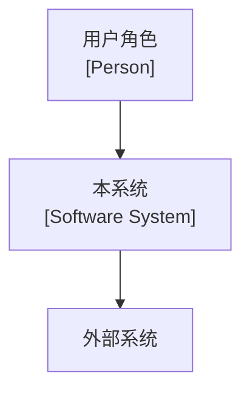
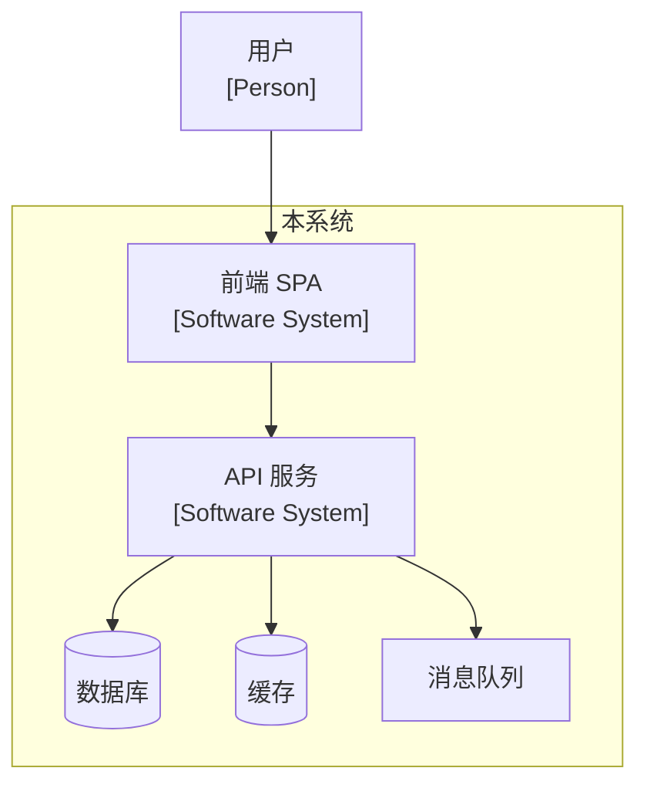
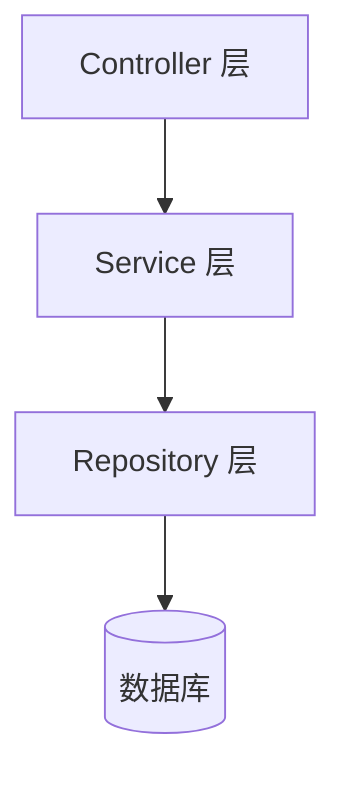
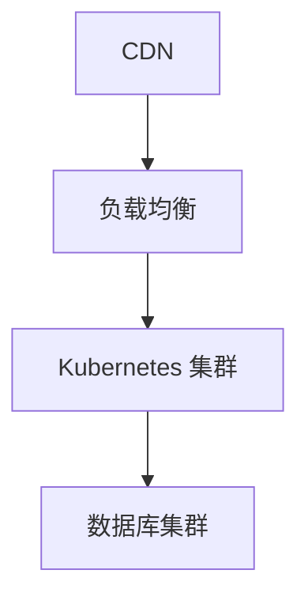

# 架构设计（C4 + 选型 + ADR）

## 核心理念

> **架构设计不是画几张图，而是做一系列不可逆的决策并记录决策理由。**
>
> 三个关键产出：
> 1. **C4 架构图**（L1 Context + L2 Container + L3 Component）— 可视化架构
> 2. **技术选型对比**（每个选型至少 2 个候选方案）— 有据可查的决策
> 3. **ADR 架构决策记录**（每个关键决策一个 ADR）— 决策历史
>
> 来源：SDD Phase 2 完整模板 + C4 建模方法 + ADR 纪律。

## 与内置架构能力的分工（编排层）

本 skill 是**编排层**：架构**图的建模**交给 Qoder 内置插件（用 Skill 工具按限定名触发），本 skill 只承担内置给不了的那部分——业务目标与约束、该画到哪一级、选型对比、ADR 纪律、质量门禁。

| 环节 | 交给内置（插件全名:目录名） | 本 skill 判什么 |
|------|--------------------------|----------------|
| C4 图源文件（L1/L2/L3 的 Structurizr DSL 与视图维护） | `architecture-visualization:c4model`（目录名 `c4model`） | 每级必须含哪些业务元素、画到哪一级算达标（Step 2 的三级要求 + 产出契约的「C4≥L2」） |
| "当前架构到底是什么"的取证（从代码/配置/边界反推现状模型） | `architecture-visualization:system-modeler`（目录名 `system-modeler`） | 现状与目标的差哪些要立 ADR（Step 3 选型、Step 6 ADR） |

🔴 **这些是内置能力，不要复刻**：不要再维护第二份模型真值——不抄一份平行的元素/关系清单，不为它们另写一套 C4 解析或建模规则。
> ⚠️ **交付格式不变**：ARCH.md 里的图**仍以 Mermaid 落盘**（`spec-templates/ARCH-template.md` 明文 "All architecture diagrams use Mermaid"，可视化面板也是 Mermaid+ELK 布局，直接贴 Structurizr DSL 面板就画不出来）。正确做法是让内置完成建模，再把结果**导出成 Mermaid** 贴进 ARCH；DSL 源文件留在 `docs/arch/` 由内置那侧维护，两处不一致时以模型为准。只有内置插件未安装时才按 Step 2 的三级要求手画，并在 ARCH 文档开头标注"未用内置建模能力"——这样装了插件能直接换轨，不会跟手写稿打架。

## 产出契约（环节卡为单一契约源）

| 项 | 契约 |
|----|------|
| 产出物 | `docs/arch/ARCH-{项目代号}.md`（C4≥L2 Mermaid、选型≥2 备选对比、数据模型概要；Full-Stack 含前端与通信章节）+ `docs/arch/adr/ADR-*.md`（≥2 篇，上下文/决策/后果齐全） |
| 模板依赖 | `docs/harness-templates/ARCH-template.md` |
| 归档位置 | `docs/arch/`（扁平；ADR 在 `adr/` 子目录） |
| 产出自检 | 每项选型≥2 对比；C4 至少 L2；≥2 篇 ADR；数据模型概要不缺；不画到实现细节 |
| 收尾 | 3 步同步（`maturity.arch=true`；PROJECT-LIVE.md 进展图与拓扑分区随同步更新） |

## 触发条件

- 用户输入 `/create-architecture`
- PRD 已冻结，需要进入架构设计阶段
- 需要评估技术选型
- 需要记录架构决策

## 前置条件

- [ ] PRD/MRD 已冻结
- [ ] 非功能需求已量化（性能/可用性/安全）
- [ ] 技术约束已明确

## 执行步骤

---

### Step 1: 架构目标与约束

**从 PRD 非功能需求推导架构目标：**

| 质量属性 | 目标（量化） | 优先级 | 约束来源 |
|---------|------------|--------|---------|
| 性能 | P99 < [X]ms | 高 | PRD 5.1 |
| 可用性 | [99.9%] | 高 | PRD 5.2 |
| 可扩展性 | 支持 [X] 倍流量增长 | 中 | 业务预期 |
| 可维护性 | 模块独立部署 | 中 | 团队规模 |
| 安全性 | [零信任/等保X级] | 高 | 合规要求 |

**架构约束：**
- 技术约束：[必须使用/禁止使用的技术]
- 组织约束：[团队规模、技能分布]
- 合规约束：[数据不出境、GDPR 等]
- 预算约束：[云资源月预算]

---

### Step 2: C4 架构图

> 建模本身走 `architecture-visualization:c4model`（见上文「与内置架构能力的分工」）。本节是**验收口径**——规定每级必须出现什么，不是绘图教程。

#### 2.1 Level 1 — 系统上下文图

> 展示系统与外部用户、系统的关系。



**C4 标注规范：**
- Person 节点：标注 `[Person]`
- 本系统及 Provider 系统：标注 `[Software System]`
- 外部/第三方系统：不加 `[Software System]` 标签
- 使用 `"..."` 引号语法 + `<br/>` 实现多行标签

#### 2.2 Level 2 — 容器图

> 展示系统内部的主要容器（服务、数据库、消息队列等）。



**容器图规范：**
- 优先 top-down（`graph TD`）布局
- 同一应用的容器用 `subgraph` 分组
- 标注技术栈和端口

#### 2.3 Level 3 — 组件图（核心服务）

> 展示核心服务内部的组件结构。



**组件图规范：**
- 展示分层依赖方向
- 标注每层的职责和可依赖/禁止依赖

---

### Step 3: 技术选型对比

> **每个选型必须有至少 2 个候选方案的量化对比。**

**选型模板：**

| 维度 | 选项 A: [名称] | 选项 B: [名称] | 选项 C: [名称] |
|------|---------------|---------------|---------------|
| 性能 | ⭐⭐⭐⭐⭐ | ⭐⭐⭐⭐ | ⭐⭐⭐ |
| 开发效率 | ⭐⭐⭐ | ⭐⭐⭐⭐ | ⭐⭐⭐⭐⭐ |
| 生态成熟度 | ⭐⭐⭐⭐ | ⭐⭐⭐⭐⭐ | ⭐⭐⭐⭐ |
| 团队熟悉度 | ⭐⭐⭐ | ⭐⭐⭐⭐⭐ | ⭐⭐ |
| 运维成本 | ⭐⭐⭐⭐⭐ | ⭐⭐⭐ | ⭐⭐⭐⭐ |

**决策**: 选择 [选项 X]
**理由**: [关键决策理由]
**关联 ADR**: ADR-NNN

#### 选型拍板选择卡（需用户决策时必须遵守）

> **本节适用场景**：当某项选型存在 ≥2 候选且无明显优劣、需要用户拍板时，用 AskUserQuestion 选择卡征询。
> **纪律来源**：全局规则 `.qoder/rules/ask-card-option-quality.md`（always-on）+ `ask-card-guard` PreToolUse hook 机械兜底。

**选项构造契约（强制，可见字段承载）**：
0. **平台渲染事实**（取证结论，与全局规则同源）：`options[].label` **会渲染**且是选项行唯一的主色字段，答完后模型收到的 `tool_result` **只含 label**；`description` 同行弱色、单行截断、**永不回传给模型**；「推荐」徽标由平台**硬编码挂给第 1 个选项**；行首徽标是数字 1/2/3/4 且可键直选
1. `label` = **具体候选值本身**（技术名/方案名，≤16 CJK 字），名词短语；**不加字母锚点前缀**（`A ·`/`B ·` 之类一律不写：平台已按序挂数字徽标，再写编号就是第二个互相矛盾的排序信号），**不写「（推荐）」**（徽标已硬挂第 1 项），禁止用评价性文字替代方案名
2. `description` = `{量化影响}；{推荐理由}`，≤40 字一行读完；**不得以 label 原文或【label】开头**（值已在 label 显示，重复即浪费这唯一一行预算），量化维度取 5 维（性能/生态/团队熟悉度/运维成本/云原生契合度）中的相关项
3. `question` 只写问题本身（≤2 行，平台一次只显一题），**不追加末尾值清单**——候选值已由 label 直接可见，清单是纯冗余且挤占 question 预算
4. 渲染后逐选项自检三问：`label` 是不是一眼可区分的具体方案名？推荐项是否排在第 1 位且 label 内没有推荐标记？`description` 是否不以方案名开头？
5. **超长时截评价不截值** —— 方案名永远优先保留；`options` 2–4 个是工具硬约束，候选多于 4 个先按维度分组再发卡
6. **同批选项写法必须一致**（部分带量化、部分只写名字 = 生成缺陷，会被 hook 的 H6 跨选项一致性检查拦下）

**高频选型预置候选**（label 照抄表内方案名，推荐项挪到第 1 位；description 按项目实际量化，禁止以方案名开头）：

| 选型维度 | 预置 label（候选值，不分先后） | description 需覆盖的量化维度 |
|---------|--------------------------------|---------------------------|
| 编辑器/富文本方案 | 纯 Markdown 源码编辑／输入即渲染（Typora 类）／自研块状富文本编辑器 | 工程量；非技术用户上手门槛；数据主权与导出承诺 |
| 后端语言/框架 | Java + Spring Boot 3／Go + Gin／Python + FastAPI／Node + NestJS | 性能基线；团队熟悉度；生态成熟度；招聘难度 |
| 前端框架 | React 18 + Vite／Vue 3 + Nuxt／SvelteKit | 团队栈；SSR 需求；生态与组件库可用性 |
| 状态管理 | Zustand／Redux Toolkit／Jotai／仅 Context | 应用复杂度；DevTools 需求；学习曲线 |
| CSS 方案 | Tailwind CSS／CSS Modules／styled-components | 设计系统契合度；团队协作；构建体积 |
| 数据库 | PostgreSQL 16／MySQL 8／MongoDB 7／SQLite | 数据模型契合度；运维成本；扩展性；团队经验 |
| 通信模式 | REST 同步／gRPC 同步／消息队列异步／REST + WebSocket 混合 | 延迟要求；耦合度；可观测性；失败恢复 |
| 部署形态 | Docker 单容器／K8s 多副本／Serverless／传统 VM + systemd | 规模预期；运维能力；成本；弹性需求 |
| 缓存策略 | Redis 集中式／进程内本地缓存／多级缓存／不缓存 | 一致性要求；命中率预期；运维复杂度 |

**发卡格式示例**（字段值按上表填充）：

```text
question = ADR-{N} 选择哪个方案？
options  = [{label:"纯 Markdown 源码编辑", description:"工程量约 2 人日；非技术用户需学习 Markdown 语法"},
            {label:"输入即渲染（Typora 类）", description:"工程量约 8 人日；非技术用户零学习成本"}]
（推荐项放第 1 个；label 不写编号与推荐标记；description 不以方案名开头）
```

> **未列入表格的开放式选型**：同样遵守上述契约——label 写具体方案名（不加字母锚点、不带「（推荐）」），description 写量化影响与理由（不以方案名开头），question 不附值清单。
> **禁止做法**：① 把 lengthy 权衡塞进 label（如 ❌ `label="开发最快、技术用户亲切，但非技术用户上手门槛高"` → 方案名缺位，用户盲选）；② 把候选值抄进 description 前缀或 question 末尾（v9 因误判「label 不渲染」而设的双通道，模型侧收不到 description，抄一遍等于只给用户看了一次，仍不在记忆里）。

---

### Step 4: 前端架构设计（Full-Stack 应用必须）

> **Backend-Only 应用跳过本步。** Full-Stack 应用必须完成以下全部子项：

#### 4.1 前端技术栈详表

| 类别 | 选择 | 版本 | 理由 |
|------|------|------|------|
| 框架 | [React/Vue/...] | [版本] | [理由] |
| 语言 | TypeScript | [版本] | [理由] |
| 构建工具 | [Vite/Webpack/...] | [版本] | [理由] |
| 路由 | [React Router/Vue Router/...] | [版本] | [理由] |
| 状态管理 | [Zustand/Pinia/...] | [版本] | [理由] |
| UI 库 | [Ant Design/Element Plus/...] | [版本] | [理由] |
| HTTP 客户端 | [Axios/fetch/...] | [版本] | [理由] |
| CSS 方案 | [Tailwind/CSS Modules/...] | [版本] | [理由] |

#### 4.2 Page → Container → Component 三层架构

| 层 | 职责 | 示例 |
|----|------|------|
| Page | 路由入口、布局编排、数据获取 | `OrderListPage` |
| Container | 业务编排、状态联动、API 调用 | `OrderTableContainer` |
| Component | 纯 UI、props 驱动、可复用 | `DataTable`, `StatusBadge` |

#### 4.3 前端目录结构

```
src/
├── api/          # API client layer (organized by domain)
├── stores/       # Global state stores
├── hooks/        # Custom hooks (shared logic)
├── pages/        # Page-level components (route targets)
├── containers/   # Container components (business logic)
├── components/   # Reusable UI components
├── router/       # Route configuration and guards
├── types/        # Shared TypeScript types
└── utils/        # Utility functions
```

#### 4.4 路由设计

- **路由方式**: [hash/history，及理由]
- **AuthGuard**: [受保护路由的守卫策略]
- **懒加载**: [按路由分包策略]
- **404 处理**: [回退方案]

#### 4.5 全局状态管理

| Store | 职责 | 持久化 |
|-------|------|--------|
| auth | 用户会话、Token、权限 | localStorage |
| [domain] | [领域状态] | [策略] |

#### 4.6 全局错误处理

| 错误类型 | 策略 | 用户体验 |
|---------|------|----------|
| 网络失败 | [方案] | [UX 行为] |
| 5xx 响应 | [方案] | [UX 行为] |
| 未捕获异常 | ErrorBoundary | [回退 UI] |
| 认证过期 | [方案] | [跳转行为] |

#### 4.7 前端性能预算

| 指标 | 目标 | 说明 |
|------|------|------|
| FCP | ≤ [1.5s] | 首屏内容绘制 |
| LCP | ≤ [2.5s] | 最大内容绘制 |
| TTI | ≤ [3.0s] | 可交互时间 |
| CLS | ≤ [0.1] | 布局偏移 |
| Bundle (gzip) | ≤ [150KB] | 初始 JS chunk |

---

### Step 5: 前后端通信设计（Full-Stack 应用必须）

> **Backend-Only 应用跳过本步。**

#### 5.1 通信模式选型

| 模式 | 适用场景 | 优点 | 缺点 | 决策 |
|------|---------|------|------|------|
| RESTful HTTP/JSON | 常规 CRUD | [优点] | [缺点] | [✓/✗] |
| WebSocket | 实时同步 | [优点] | [缺点] | [✓/✗] |
| SSE | 服务端推送 | [优点] | [缺点] | [✓/✗] |

#### 5.2 契约同步机制

- **Spec 源**: [OpenAPI spec 存放位置]
- **更新机制**: [spec 变更如何传递到前端]
- **代码生成**: [是否自动生成 API client]

#### 5.3 Token 获取与刷新

- **Token 类型**: [JWT/opaque/session]
- **获取**: [登录流程概述]
- **刷新**: [刷新策略概述]
- **存储**: [客户端存储位置]

#### 5.4 Mock 策略

| 阶段 | 方案 | 工具 |
|------|------|------|
| 开发 | [方案] | [工具] |
| 联调 | [方案] | [工具] |
| 降级 | [方案] | [工具] |

---

### Step 6: ADR 架构决策记录

> **每个关键架构决策必须有 ADR。每个 ADR 必须列出至少 2 个替代方案。**

**ADR 模板：**

```markdown
# ADR-NNN: <决策标题>

## 决策日期
<YYYY-MM-DD>

## 决策状态
Accepted / Deprecated / Superseded by ADR-XXX

## 决策者
<角色> (<姓名>)

## 上下文
<技术背景、业务驱动、为什么现在需要做这个决策。2-3 段。>

## 决策
<最终选择的方案及其核心理由。1-2 段。>

## 替代方案

| 方案 | 优点 | 缺点 |
|------|------|------|
| 方案 A | <优点> | <缺点> |
| 方案 B | <优点> | <缺点> |
| **选定方案** | <优点> | <缺点> |

## 后果

- **正面影响**:
  - <好处 1>
  - <好处 2>
- **负面影响**:
  - <代价 1>
  - <代价 2>
- **风险点**:
  - <风险 1>: <触发条件>
  - <风险 2>: <触发条件>
```

**ADR 纪律：**
1. 一个 ADR 只记录一个决策
2. 一旦 Accepted，内容不可修改（新 ADR 替代旧 ADR）
3. 必须列出至少 2 个未选方案
4. 必须诚实记录负面影响和风险
5. 每个架构文档至少 2 个 ADR

> **ADR 替代方案征询用户时**：若用 AskUserQuestion 选择卡承载"≥2 替代方案"，遵守 `.qoder/rules/ask-card-option-quality.md`——label 写具体方案名（≤16字）、description 写权衡与后果、超长截评价不截值、同批写法一致。ADR 文档正文仍按完整模板记录（上下文/决策/后果/替代方案对比表）。

---

### Step 7: 部署架构



**环境规划：**
| 环境 | 用途 | 配置 | 数据 |
|------|------|------|------|
| dev | 开发联调 | [规格] | Mock |
| staging | 预发布验证 | [规格] | 脱敏生产 |
| prod | 生产 | [规格] | 真实 |

---

### Step 8: 质量门禁检查

> **v8.4.0 入参优先与对外表述**：骨架 2·2 提示词已内联红队三视角（容量与性能 / 数据与一致性 / 安全与合规），用户显式给出视角清单或人数时**以提示词为准**；对用户一律用“找这份架构的毛病、逐条给通过结论”这类说法，本文件内的字段名与内部工具名（含 SE 签批、RT 编号的机制描述）不得写进用户可见提示词。

- [ ] C4 图至少到 L2（大型项目需 L3）
- [ ] 每项选型有 >= 2 候选方案量化对比
- [ ] >= 2 个 ADR 含完整替代方案分析
- [ ] 非功能需求有对应的架构策略
- [ ] 部署架构考虑了高可用
- [ ] 中间件容量有规划
- [ ] 与 PRD 非功能需求一致
- [ ] 下游交接信息完整
- [ ] Full-Stack：前端架构含技术栈/三层架构/目录/路由/状态/错误处理/性能预算
- [ ] Full-Stack：前后端通信含模式选型/契约同步/Token 策略/Mock 方案

---

### Step 9: 追加 harness-continuous-sync 同步步骤

**执行 harness-continuous-sync 步骤 1-3**（唯一规范：.qoder/commands/live-refresh.md）。

## 失败处理

| 失败场景 | 处理方式 |
|----------|---------|
| PRD 非功能需求未量化 | 暂停架构设计，回到 PRD 补充量化指标 |
| 技术选型团队无共识 | 做 PoC（概念验证），用数据说话 |
| 架构过于复杂 | 简化。如果不能用一页纸解释清楚，说明过度设计 |
| 与现有架构冲突 | 创建 ADR 记录迁移策略，采用"接触即迁移" |
