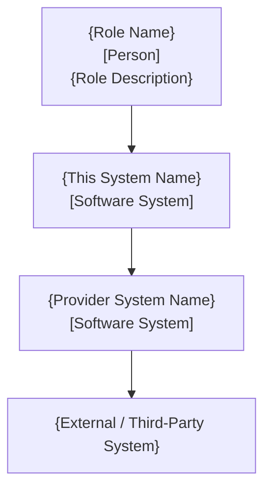

# {系统名称} 架构设计文档 (Architecture Design Document)

> **版本**: v1.0.0 | **日期**: YYYY-MM-DD | **状态**: 草稿 / 评审中 / 已冻结（三值由该步自检清单驱动：清单全过即写"已冻结"，由产出方落盘时直接写，不等用户口令）
> **应用类型**: `Backend-Only` / `Full-Stack`
> **契约角色**: Provider / Consumer / Both

---

## 修订记录

| 版本 | 日期 | 作者 | 变更说明 |
|------|------|------|----------|
| v1.0.0 | YYYY-MM-DD | {author} | 初始版本 |

---

## 目录

- [0. 文档信息 (Document Information)](#0-document-information)
- [1. 应用概述 (Application Overview)](#1-application-overview)
- [2. 后端架构、选型与约束 (Backend Architecture, Selection and Constraints)](#2-backend-architecture-selection-and-constraints)
- [3. 前端架构与选型 (Frontend Architecture and Selection, Full-Stack Only)](#3-frontend-architecture-and-selection-full-stack-only)
- [4. 前后端通信框架 (Frontend-Backend Communication, Full-Stack Only)](#4-frontend-backend-communication-framework-full-stack-only)
- [5. 中间件选型 (Middleware Selection)](#5-middleware-selection)
- [附录 (Appendix)](#appendix)

---

### 0. 文档信息 (Document Information)

#### 0.1 版本 / 作者 / 日期 / 状态 (Version / Author / Date / Status)

| Version | Author | Date | Status |
|---------|--------|------|--------|
| v1.0.0 | {name} | YYYY-MM-DD | Draft |

#### 0.2 评审记录 (Review Records)

| Reviewer | Date | Result | Notes |
|----------|------|--------|-------|
| | | | |

---

### 1. 应用概述 (Application Overview)

#### 1.1 职责声明 (Responsibility Statement)

> Align with PRD module boundaries. Describe the core responsibilities and domain this application owns.

{Describe what this application does, its domain boundary, and its position in the overall system.}

#### 1.2 依赖澄清 (Dependency Clarification)

> Align with PRD Inter-Application Dependency Contract.

| Direction | Application | Communication | Capability |
|-----------|------------|---------------|------------|
| I depend on | {provider app} | {protocol} | {capability description} |
| Depends on me | {consumer app} | {protocol} | {capability description} |

#### 1.3 应用间通信选型 (Inter-Application Communication Framework Selection)

> Compare ≥2 candidates. Record key decisions as ADR.

| Candidate | Pros | Cons | Decision |
|-----------|------|------|----------|
| HTTP REST | {pros} | {cons} | |
| gRPC | {pros} | {cons} | |
| Message Queue | {pros} | {cons} | |

**Decision**: {Selected approach and rationale. Link to ADR-NNN.}

#### 1.4 C4 上下文图 (Context Diagram)

> Show the system in its environment: users, external systems, and other applications it interacts with. Full-Stack applications MUST include the End User and Frontend SPA nodes.
>
> **Backend-Only**: only show API consumers (other services / external systems), Provider dependencies, and third-party services. Do NOT include a frontend SPA.

> **C4 Notation Conventions**:
> - **Person** nodes (end users / roles): label with `[Person]` below the role name.
> - **Internal Software System** nodes (this app, provider apps): label with `[Software System]` below the system name.
> - **External / third-party system** nodes: do NOT add `[Software System]` label — use plain text only.
> - Use `"..."` quoted node syntax with `<br/>` to render multi-line labels.



#### 1.5 C4 容器图 (Container Diagram)

> Show the high-level technical building blocks. Full-Stack applications MUST include: Frontend SPA, Backend API, Gateway (optional), Provider backend references, static assets/CDN. (BFF is forbidden — see Appendix A.)
>
> **Backend-Only**: do NOT include Frontend SPA or CDN nodes. Show API server, background workers, database, cache, and message broker as appropriate.

> **C4 Notation Conventions**:
> - Direction: prefer top-down (`graph TD`) so end users sit at the top and downstream systems flow downward.
> - **Service / Container** nodes: label with `[Software System]` and the **owning application** name (e.g. `B2C Mall`, `BPaaS Platform`) for traceability.
> - Group containers of the same application using `subgraph`. Frontend SPA, Backend services, and Provider services should each live in their own subgraph.
> - **Gateway** (e.g. MSE Gateway) is rendered as a thin layer using the `[[...]]` node shape.
> - Cross-application calls go through the gateway; do NOT draw direct frontend → provider arrows (BFF is forbidden — see Appendix A).

```mermaid
graph TD
    %% === Persons ===
    User["{Role Name}<br/>[Person]"]

    %% === This Application (Full-Stack example) ===
    subgraph {Application Name}
        direction TB
        subgraph {App}-FE[{App} SPA]
            FE_Mod1[{Page Module 1}]
            FE_Mod2[{Page Module 2}]
        end
        subgraph {App}-BE[{App} Backend]
            BE_Mod1["{service-name}<br/>[Software System]<br/>{Owning App}"]
            BE_Mod2["{service-name}<br/>[Software System]<br/>{Owning App}"]
        end
    end

    %% === Gateway (thin layer) ===
    MSE[[MSE Gateway]]

    %% === Provider Platform (grouped by domain) ===
    subgraph {Provider Platform Name}
        subgraph {Domain Name}
            Svc1["{service-name}<br/>[Software System]<br/>{Owning App}<br/>{Responsibility}"]
        end
    end

    %% === Relationships ===
    User --> {App}-FE
    FE_Mod1 -- RESTful --> BE_Mod1
    FE_Mod2 -- RESTful --> BE_Mod2
    BE_Mod1 --> MSE
    BE_Mod2 --> MSE
    MSE --> Svc1
```

---

### 1.6 模块级设计前置信息 (Module-Level Design Prerequisites)

> 环节 3 模块设计批次划分与 Provider-first 排序的输入；跨模块一致性（API 对称/共享 DTO/错误码/事件）的声明基准。

#### 1.6.1 模块间依赖矩阵 (Inter-Module Dependency Matrix)

| Provider 模块 ↓ / Consumer 模块 → | {Module A} | {Module B} | {Module C} |
|-----------------------------------|-----------|-----------|-----------|
| {Module A} | — | {API/事件} | {API/事件} |
| {Module B} | | — | |
| {Module C} | | | — |

> 声明每个模块依赖哪些模块的哪些能力（API/事件/共享类型）。依赖必须无环；循环依赖须回环节 2 重新划分模块。

#### 1.6.2 共享 DTO/枚举归属表 (Shared DTO & Enum Ownership)

| 共享类型 | 归属模块（唯一定义方） | 引用方式 |
|---------|---------------------|---------|
| {SharedDto} | {Module A} | 其他模块 $ref 引用，禁止重复定义 |
| {SharedEnum} | {Module B} | 同上 |

#### 1.6.3 错误码分段分配 (Error Code Segment Allocation)

| 模块 | 错误码段 | 说明 |
|------|---------|------|
| {Module A} | {prefix}-1xxx | 本模块业务错误码子区间 |
| {Module B} | {prefix}-2xxx | 本模块业务错误码子区间 |

> 按模块分段分配业务错误码子区间，防止并行设计撞号；公共/框架错误码（认证/限流/参数校验）不计入分段。

#### 1.6.4 事件 Topic 命名与载荷归属 (Event Topic & Payload Ownership)

| 事件 Topic | 生产者模块 | 消费者模块 | 载荷 Schema 归属 |
|-----------|-----------|-----------|----------------|
| {topic.name} | {Module A} | {Module B} | {Module A} |

---

### 2. 后端架构、选型与约束 (Backend Architecture, Selection and Constraints)

#### 2.1 编程语言选型 (Programming Language Selection)

> Compare ≥2 candidates with quantified criteria (performance, ecosystem, team expertise, hiring market).

| Candidate | Performance | Ecosystem | Team Expertise | Decision |
|-----------|-------------|-----------|----------------|----------|
| {Lang A} | {metrics} | {rating} | {level} | |
| {Lang B} | {metrics} | {rating} | {level} | |

**Decision**: {Selected language and version. Link to ADR if non-obvious.}

#### 2.2 Web 框架选型 (Web Framework Selection)

> Compare ≥2 candidates.

| Candidate | Maturity | Performance | Learning Curve | Community | Decision |
|-----------|----------|-------------|----------------|-----------|----------|
| {Framework A} | {rating} | {metrics} | {rating} | {rating} | |
| {Framework B} | {rating} | {metrics} | {rating} | {rating} | |

**Decision**: {Selected framework and version.}

#### 2.3 API 通信协议 (API Communication Protocol)

> Select from: HTTP/1.1 / HTTP/2 / HTTPS / WebSocket / gRPC. Justify choice.

**Selection**: {Protocol} — {Rationale}

#### 2.4 数据格式 (Data Format)

> Select from: JSON / XML / Protobuf / YAML. Justify choice.

**Selection**: {Format} — {Rationale}

#### 2.5 API 风格 (API Style)

> Select from: RESTful / GraphQL / RPC. This is a selection declaration ONLY — detailed interface design specs are NOT produced here.

**Selection**: {Style} — {Rationale}

---

### 3. 前端架构与选型 (Frontend Architecture and Selection, Full-Stack Only)

> **Backend-Only 应用跳过本章。**

#### 3.1 技术栈选型 (Tech Stack Selection)

| Category | Choice | Version | Rationale |
|----------|--------|---------|-----------|
| Framework | React / Vue / ... | {version} | {rationale} |
| Language | TypeScript | {version} | {rationale} |
| Build Tool | Vite / Webpack / ... | {version} | {rationale} |
| Router | React Router / Vue Router / ... | {version} | {rationale} |
| State Management | Zustand / Pinia / ... | {version} | {rationale} |
| UI Library | Ant Design / Element Plus / ... | {version} | {rationale} |
| HTTP Client | Axios / fetch wrapper / ... | {version} | {rationale} |
| CSS Framework | Tailwind / CSS Modules / ... | {version} | {rationale} |

#### 3.2 整体架构 (Overall Architecture)

> Define the Page → Container → Component three-layer architecture responsibilities.

| Layer | Responsibility | Example |
|-------|---------------|---------|
| Page | Route entry, layout orchestration, data fetching | `OrderListPage` |
| Container | Business logic, state wiring, API calls | `OrderTableContainer` |
| Component | Pure UI rendering, props-driven, reusable | `DataTable`, `StatusBadge` |

#### 3.3 目录结构 (Directory Structure)

> System-level directory baseline. Per-page structure deferred to detailed design.

```
src/
├── api/          # API client layer (organized by domain)
├── stores/       # Global state stores
├── hooks/        # Custom hooks (shared logic)
├── pages/        # Page-level components (route targets)
├── containers/   # Container components (business logic)
├── components/   # Reusable UI components
├── router/       # Route configuration and guards
├── types/        # Shared TypeScript types
└── utils/        # Utility functions
```

#### 3.4 路由设计 (Routing Design)

> Define: overall routing approach, AuthGuard strategy, lazy loading, 404 handling, route versioning.

- **Routing approach**: {hash / history mode, rationale}
- **AuthGuard**: {guard strategy for protected routes}
- **Lazy loading**: {code-splitting strategy per route}
- **404 / fallback**: {handling approach}
- **Versioning**: {route versioning strategy if applicable}

#### 3.5 全局状态管理 (Global State)

> Define store partitioning strategy. Auth store is mandatory; business stores split by domain.

| Store | Responsibility | Persistence |
|-------|---------------|-------------|
| auth | User session, token, permissions | localStorage |
| {domain} | {domain-specific state} | {strategy} |

#### 3.6 全局错误处理 (Global Error Handling)

> Define strategies for: network errors, 5xx responses, ErrorBoundary, error reporting, graceful degradation.

| Error Type | Strategy | User Experience |
|-----------|----------|----------------|
| Network failure | {approach} | {UX behavior} |
| 5xx response | {approach} | {UX behavior} |
| Unhandled exception | ErrorBoundary | {fallback UI} |
| Auth expiry | {approach} | {redirect behavior} |

---

### 4. 前后端通信框架 (Frontend-Backend Communication, Full-Stack Only)

> **Backend-Only 应用跳过本章。** (BFF 禁止 — 见附录 A)

#### 4.1 通信模式选型 (Communication Pattern Selection)

> Regular CRUD → RESTful HTTP/JSON; High-realtime → WebSocket/SSE. Compare ≥2 candidates.

| Pattern | Use Case | Pros | Cons | Decision |
|---------|----------|------|------|----------|
| RESTful HTTP/JSON | {scenario} | {pros} | {cons} | |
| WebSocket | {scenario} | {pros} | {cons} | |
| SSE | {scenario} | {pros} | {cons} | |

#### 4.2 契约同步机制 (Contract Synchronization)

> Define OpenAPI Spec source and update mechanism. Spec details are produced by detailed-designer.

- **Spec source**: {where the OpenAPI spec lives}
- **Update mechanism**: {how spec changes propagate to frontend}
- **Code generation**: {whether API client code is auto-generated}

#### 4.3 Token 获取与刷新 (Auth Token Acquisition and Refresh Flow)

> High-level selection only. Detailed approach deferred to detailed-designer.

- **Token type**: {JWT / opaque / session}
- **Acquisition**: {login flow overview}
- **Refresh**: {refresh strategy overview}
- **Storage**: {where tokens are stored client-side}

#### 4.4 Mock 策略 (Mock Strategy)

| Phase | Approach | Tool |
|-------|----------|------|
| Development | {strategy} | {tool} |
| Integration | {strategy} | {tool} |
| Degradation | {strategy} | {tool} |

---

### 5. 中间件选型 (Middleware Selection)

#### 5.1 消息队列 (Message Queue)

> Compare ≥2 candidates. Skip if not applicable (state "Not Required" with justification).

| Candidate | Throughput | Reliability | Ops Complexity | Team Experience | Decision |
|-----------|-----------|-------------|----------------|-----------------|----------|
| {MQ A} | {metrics} | {rating} | {rating} | {level} | |
| {MQ B} | {metrics} | {rating} | {rating} | {level} | |

#### 5.2 数据库存储 (Database Storage)

> Compare ≥2 candidates per storage category (Relational / NoSQL / Search / Time-series).

| Category | Candidate | Pros | Cons | Decision |
|----------|-----------|------|------|----------|
| Relational | {DB A} | {pros} | {cons} | |
| Relational | {DB B} | {pros} | {cons} | |

#### 5.3 CDN（如适用）(CDN, If Applicable)

> State "Not Applicable" if this backend does not serve static assets.

#### 5.4 缓存 (Cache)

> Compare Redis / Memcached / Local cache strategies.

| Candidate | Use Case | Pros | Cons | Decision |
|-----------|----------|------|------|----------|
| {Cache A} | {scenario} | {pros} | {cons} | |
| {Cache B} | {scenario} | {pros} | {cons} | |

#### 5.5 对象存储（如适用）(Object Storage, If Applicable)

> State "Not Applicable" if not needed.

#### 5.6 日志记录 (Logging)

> Define collection, storage, and query solution.

| Layer | Tool/Service | Purpose |
|-------|-------------|---------|
| Collection | {tool} | {purpose} |
| Storage | {tool} | {purpose} |
| Query | {tool} | {purpose} |

#### 5.7 监控与可观测性 (Monitoring and Observability)

> Define Metrics / Tracing / Logging solution stack.

| Pillar | Tool/Service | Purpose |
|--------|-------------|---------|
| Metrics | {tool} | {purpose} |
| Tracing | {tool} | {purpose} |
| Logging | {tool} | {purpose} |

#### 5.8 备选方案记录 (Alternative Options Record)

> All unselected options documented in ADR for future reference.

---

## 附录 (Appendix)

### A. 通用约定 (Universal Conventions)

- **File name**: `arch-{system}-架构设计文档.md`
- **Output directory**: `docs/arch/`
- **ADR location**: `docs/arch/adr/{system}/ADR-NNN-{slug}.md`
- **Diagram language**: All architecture diagrams use Mermaid.
- **Subgraph naming**: Parentheses (Chinese `（）` or English `()`) are FORBIDDEN in subgraph names. Use ` - ` dash separator instead (e.g., `subgraph Backend Layer - Independent Deployment`).
- **C4 scope**: This document covers ONLY Context and Container levels. Component/Code levels belong to detailed design.
- **No BFF rule**: BFF layer / BFF-named service is FORBIDDEN in any form (text, diagrams, naming). Full-Stack frontend ONLY calls its own backend; an optional gateway must not be named BFF.
- **Provider-first Freeze**: Provider applications must freeze their architecture selections (communication protocol, contract style, auth mechanism) before Consumer applications; Consumers may only choose within the Provider's frozen boundary; any Provider contract change must flow back to `/plan` for revision and trigger regression freeze for all Consumers.
- **Application type**:
  - `Backend-Only` — applications that serve APIs without a user interface (API services, middleware platforms, batch processing systems). Produce sections **0, 1., 2., 5.**, and **skip 3. and 4.** entirely.
  - `Full-Stack` — applications with a frontend (SPA/Web App) and an independent backend layer (RESTful API service). Produce **all chapters**.
  - Chapter numbering stays consistent across both types (skipped chapters do not cause renumbering).

### B. 范围边界 (Scope Boundaries)

> Items NOT produced by this document and their downstream owners.

| NOT in this document | Belongs to |
|---------------------|-----------|
| Detailed API spec (URL / DTO / error codes / OpenAPI Spec) | detailed-designer |
| Security design (auth details / token management / CSRF / XSS / access control) | detailed-designer |
| Frontend page-level design (components, styles, per-page flows) | detailed-designer |
| Database DDL / Schema | detailed-designer |
| C4 Component / Code level | detailed-designer |
| BFF layer | N/A — never allowed (see Appendix A) |

### C. 跨应用一致性要求 (Cross-Application Consistency Requirements)

| Check Item | Source | Consistency Requirement |
|-----------|--------|----------------------|
| Provider/Consumer dependency symmetry | PRD Inter-Application Dependency Contract | Each Provider capability ↔ at least one Consumer declares consumption |
| Communication protocol | 1.3 / 4.1 | Provider exposed protocol compatible with Consumer selection |
| Auth selection | ADR records | Token type and refresh mechanism names aligned |
| Middleware interconnection | 5. | No conflicts across apps (e.g., same MQ type) |
| Architecture boundary | C4 diagrams | No BFF nodes; Full-Stack frontend only calls its own backend |

**Freeze Order:**
1. All Provider application architecture documents freeze first → selections and capability boundaries confirmed.
2. All Consumer application architecture documents freeze after → referencing Provider's frozen selections.
3. Detailed API specs (OpenAPI / DTO / error codes) produced and cross-verified by detailed-designer later.

### D. 嵌入式 ADR 模板 (Embedded ADR Template)

> 每个 ADR 是独立文件，存放于 `docs/arch/adr/{system}/ADR-NNN-{slug}.md`。每个 ADR 使用以下模板。

```markdown
# ADR-{NNN}: {决策标题 (Decision Title)}

## 决策日期 (Decision Date)
{YYYY-MM-DD}

## 决策状态 (Decision Status)
Accepted / Deprecated / Superseded by ADR-XXX

## 决策者 (Decision Maker)
{角色 (Role)} ({姓名 (Name)})

## 上下文 (Context)
{技术背景、业务驱动、为什么现在需要做这个决策。2-3 段。}

## 决策 (Decision)
{最终选择的方案及其核心理由。1-2 段。}

## 替代方案 (Alternatives Considered)

| 方案 (Option) | 优点 (Pros) | 缺点 (Cons) |
|--------|------|------|
| {方案 A} | {优点} | {缺点} |
| {方案 B} | {优点} | {缺点} |
| **{选定方案}** | {优点} | {缺点} |

## 后果 (Consequences)

- **正面影响 (Positive Impact):**
  - {好处 1}
  - {好处 2}
- **负面影响 (Negative Impact):**
  - {代价 1}
  - {代价 2}
- **风险点 (Risk Points):**
  - {风险 1}: {触发条件}
  - {风险 2}: {触发条件}
```

**ADR 纪律 (ADR Discipline):**

1. **一个 ADR 只记录一个决策** — 不要合并多个决策。
2. **不可修改历史** — 一旦 Accepted，内容不修改。新 ADR 替代旧 ADR。
3. **必须列出替代方案** — 至少 2 个未选方案。
4. **诚实记录后果** — 必须记录真实的负面影响和风险。
5. **每个架构文档至少 2 个 ADR。**

### E. 质量门禁清单 (Quality Gate Checklist)

- [ ] C4 上下文图 + 容器图完成（Mermaid）
- [ ] 每项选型有 ≥2 候选方案对比
- [ ] ≥2 个 ADR 含完整替代方案分析
- [ ] 无"接口设计规格"章节（属于 SPEC）
- [ ] 无"安全设计"章节（属于 SPEC）
- [ ] 文本或图中无 BFF 层/服务
- [ ] Provider 应用先冻结，Consumer 应用后冻结
- [ ] 模块间依赖矩阵与共享约定归属已声明（1.6 节）
- [ ] 子图名称不含括号
- [ ] (Full-Stack) 前端架构含技术栈/整体架构/目录/路由/状态/错误处理
- [ ] (Full-Stack) 前端性能预算含 FCP/LCP/TTI 目标
- [ ] (Full-Stack) C4 图含前端 SPA 和 CDN 节点

### F. ADR 汇总 (ADR Summary)

| ADR 编号 | 标题 (Title) | 状态 (Status) | 决策日期 (Decision Date) | 链接 (Link) |
|--------|-------|--------|--------------|------|
| ADR-001 | {标题} | Accepted | YYYY-MM-DD | [ADR-001](./adr/{system}/ADR-001-{slug}.md) |
| ADR-002 | {标题} | Accepted | YYYY-MM-DD | [ADR-002](./adr/{system}/ADR-002-{slug}.md) |

> 每个架构文档至少 2 个 ADR。
