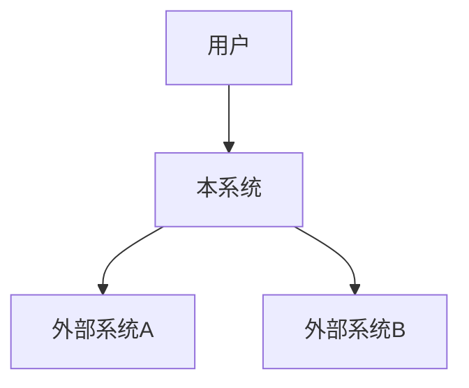
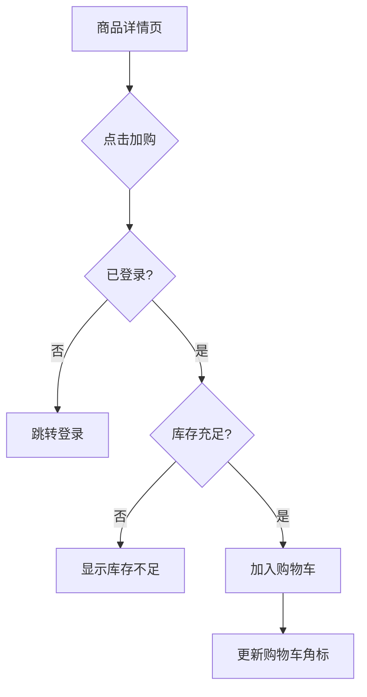

# PRD - 产品需求文档

> **文档编号**: PRD-[项目编号]-[序号]
> **版本**: v0.1
> **状态**: 草稿 | 评审中 | 已批准（三值由该步自检清单驱动：清单全过即写"已批准"，由产出方落盘时直接写，不等用户口令）
> **作者**: [姓名]
> **上游文档**: MRD-[编号]
> **应用类型**: `Backend-Only` / `Full-Stack`
> **创建日期**: [YYYY-MM-DD]
> **最后更新**: [YYYY-MM-DD]

> **文档定位**: PRD 回答"构建什么、到什么程度、什么优先级"。它**不覆盖**系统架构、数据模型、接口字段定义或部署方案 — 这些属于 SPEC。
>
> **多应用编排说明**: 每应用一份统一 PRD（拒绝文档级拆分——不产出 prd-{业务}-业务模块说明.md / 交互流程说明.md 等子文档）。统一 PRD 一份合并所有章节（业务模块 + 业务架构 + 交互流程）。多应用间 PRD 互不阻塞可并行写入，Provider 能力域定义以 MRD 为准。

---

## 1. 产品概述

### 1.1 产品定位

**一句话定位**: 为[目标用户]提供[核心能力]，解决[核心问题]。

### 1.2 产品目标（量化）

> 每个目标必须有可衡量的指标和具体数字。禁止模糊语言（"快速"、"很多"、"很好"）。

| ID | 目标 | 衡量指标 | 目标值 |
|----|------|---------|--------|
| G01 | [如：提升订单 GMV] | [如：月 GMV >= 500万] | [6个月内] |
| G02 | [如：降低购物车放弃率] | [如：购物车->下单转化率 >= 35%] | |

### 1.3 用户角色

| 角色 | 描述 | 权限级别 | 核心场景 |
|------|------|---------|---------|
| [角色1] | | | |
| [角色2] | | | |

### 1.4 应用类型声明

> **应用类型**: `Backend-Only` / `Full-Stack`

- **Backend-Only**: 仅暴露 REST/gRPC 接口，无前端层。**跳过第 4 节**。
- **Full-Stack**: 包含前端层（SPA）和后端层，独立部署。**第 4 节必填**。

---

## 2. 系统边界

### 2.1 系统上下文图



### 2.2 系统职责边界

**系统负责**:
- [ ] [职责1]

**系统不负责**（由外部系统承担）:
- [ ] [非职责1] → 由[外部系统]负责

### 2.3 应用间依赖契约

> **关键**: 仅能力级别，严格 3 列。禁止出现 API 名称、请求/响应结构、SLA 值。

#### 我依赖的应用

| 应用 | 能力（领域级） | 调用场景 |
|------|--------------|---------|
| [如：支付服务] | [如：支付发起与回调] | [如：用户确认订单→发起支付] |

#### 依赖我的应用

| 应用 | 我提供的能力（领域级） | 调用场景 |
|------|---------------------|---------|
| [如：分析平台] | [如：订单事件流] | [如：实时 GMV 看板刷新] |

### 2.4 应用内 API 约定（原则级）

> 这些是架构原则，不是详细接口定义。

| 原则 | 描述 |
|------|------|
| 路径约定 | 统一 `/api/{version}/{resource}` 路由前缀 |
| 数据格式 | JSON (UTF-8)，snake_case 字段命名 |
| 认证方式 | Bearer Token（机制在 SPEC 中定义） |
| 分页策略 | 游标分页或偏移分页 |
| 错误响应 | 结构化：`{code, message, traceId}` |
| 幂等性 | 写操作接受 `X-Idempotency-Key` |

---

## 3. 功能模块

### 3.1 模块清单

| 模块 ID | 模块名称 | 核心职责 | 优先级 |
|---------|---------|---------|--------|
| M-01 | [如：购物车] | [如：购物车 CRUD、数量校验] | P0 |
| M-02 | [如：订单] | [如：订单创建、生命周期管理] | P0 |

### 3.2 模块详情

#### M-01: [模块名称]

**模块职责**: [一句话描述]

**用户故事**:

| ID | 用户故事 | 优先级 | 验收标准 |
|----|---------|--------|----------|
| US-{APP}-001 | 作为[角色]，我希望[行为]，以便[价值] | P0 | 见下方 Gherkin |

**验收标准（Gherkin）**:

```gherkin
Feature: [功能名称]
  作为[角色]
  我希望[行为]
  以便[价值]

  Scenario: 正常场景名称
    Given [给定条件]
    When [当执行操作]
    Then [则期望结果]

  Scenario: 异常场景名称
    Given [给定条件]
    When [当执行异常操作]
    Then [则期望错误处理]

  Scenario Outline: 参数化场景
    Given [给定条件]
    When 用户输入 "<input>"
    Then 系统返回 "<expected>"

    Examples:
      | input | expected |
      | [值1] | [结果1] |
```

**前置条件（Preconditions）**:
- [ ] [用户已登录（有效会话 Token）]
- [ ] [商品存在且状态为"已上架"]

**后置条件（Postconditions）**:
- [ ] [购物车记录已持久化到数据库]
- [ ] [购物车总价已重新计算]

**异常场景**:
- [ ] [网络超时→显示重试按钮]
- [ ] [并发库存耗尽→返回 409 Conflict]

**边界条件**:
- [ ] [数量=0→拒绝，提示"至少1件"]
- [ ] [数量超过上限→截断到最大值并提示]

**业务规则**:

| 规则 ID | 规则名称 | 描述 | 约束值 |
|---------|---------|------|--------|
| BR-01 | [如：购物车上限] | [如：单个购物车最多50种商品] | 50 种 |

### 3.3 模块间依赖契约

> **关键**: 第 4 列必须是"调用场景"，不是"SLA"或"性能目标"。

#### 我依赖的模块

| 调用方模块 | 被依赖模块 | 能力 | 调用场景 |
|-----------|-----------|------|---------|
| 购物车 | 商品 | SKU 可用性检查 | 加购时校验库存 |

#### 依赖我的模块

| 被依赖模块 | 调用方模块 | 提供的能力 | 调用场景 |
|-----------|-----------|-----------|---------|
| 购物车 | 订单 | 购物车快照 | 下单时读取购物车状态 |

---

## 4. 交互流程（仅 Full-Stack 应用）

> **Backend-Only 应用跳过本节。**

### 4.0 交互原型工程契约

> Full-Stack 应用的交互原型由环节 1·步骤 3（`/prototype-scaffolding`）产出，与本节交互流程 1:1 对应。

| 项 | 契约 |
|----|------|
| 原型路径 | `docs/prd/PRD-{应用}-交互原型/`（可运行工程目录，非单 HTML） |
| 默认技术栈 | Vite + Preact + Tailwind + zustand（含 preact-router）；L1/profile 声明时以其覆盖 |
| 页面清单 | 与本节 4.1 页面清单 **1:1 对应**（多一页或少一页均视为 FAIL） |
| 数据约定 | 全部 mock 数据（脱敏样本，覆盖正常+异常），不得接入真实后端 API |
| 原型与生产分离 | 原型存 `docs/prd/`（需求资产），生产代码存 `web/`；技术栈可不同 |
| 质量门禁 | `npm run build` + `tsc --noEmit` + `npm run lint` 0 错误；路由 100% 覆盖；异常分支可触达 |
| 视觉取值来源 | 内置设计类能力（`/ui-ux-pro-max` 风格库，可用时）；不可用时降级为纯规范流程并标注待补项。🔴 本行自 v9.11.0 起**真被消费**：环节 1·3 步骤 P2.5 会据此检索并产出 `design-system/{项目代号}/MASTER.md`；**属主已裁定的方向优先于检索库推荐**（实测库推荐本身可能就是通稿默认），两者不一致时以本行为准并记一行理由 |

### 4.1 页面清单与层级

```
/ (Root)
├── /home          — 首页
├── /products/:id  — 商品详情
├── /cart          — 购物车
├── /checkout      — 结算流程
└── /orders        — 订单列表
```

### 4.2 页面-模块-US 映射

| 页面 | 模块 | 关联 US |
|------|------|----------|
| /cart | 购物车 | US-{APP}-CART-001, US-{APP}-CART-002 |

### 4.3 核心用户流程



---

## 5. 非功能需求

> **ARCH 前向引用原则**：PRD 不写 SLA / P99 / 容量数字 / API / DTO，统一以“详见 ARCH”占位，避免与下游冲突。

### 5.1 性能方向

> 性能与容量指标：详见 `docs/arch/ARCH-{项目代号}.md` Ch.容量规划

- 预期规模方向：[DAU 方向级，如 ~50K，禁写 P99/QPS 精确值]
- 峰值场景：[如“秒杀”“大促”等场景描述，具体容量留 ARCH]

### 5.2 可用性方向

> 可用性 SLA / RTO / RPO：详见 `docs/arch/ARCH-{项目代号}.md` Ch.可用性设计

- 可用性方向：[如“高可用”“容灾”等方向级描述，禁写 99.9% 等精确值]

### 5.3 安全方向

> 认证/授权机制实现细节：详见 `docs/arch/ARCH-{项目代号}.md` Ch.安全架构

- 认证方向：[OAuth2/JWT/... 方向级声明，具体实现留 ARCH]
- 授权方向：[RBAC/ABAC/... 方向级声明，具体模型留 ARCH]
- 合规要求：[如“国内基础合规”“金融级合规”等，具体实施留 ARCH]

---

## 6. 优先级与里程碑

### 6.1 优先级矩阵

| 优先级 | 功能项 | 关联 US | 理由 |
|--------|--------|---------|------|
| P0-必须 | | | |
| P1-应该 | | | |
| P2-可以 | | | |

### 6.2 里程碑计划

| 里程碑 | 时间 | 交付内容 | 验收标准 |
|--------|------|---------|---------|
| M1-MVP | [日期] | | |
| M2-Beta | [日期] | | |

---

## 7. 下游交接

| 下游 | 文档 | 交接内容 |
|------|------|---------|
| 架构师 | ARCH | 非功能需求、系统边界、技术约束 |
| 后端 | SPEC-BE | API 定义、领域模型、数据需求 |
| 前端 | SPEC-FE | 页面清单、交互流程、状态管理 |
| 测试 | SPEC-TEST | 验收标准、测试范围、质量门禁 |

---

## 附录

### A. 术语表
| 术语 | 定义 |
|------|------|
| | |

### B. 变更记录
| 版本 | 日期 | 作者 | 变更内容 |
|------|------|------|---------|
| v0.1 | [日期] | [作者] | 初稿 |

---

## 质量检查清单

- [ ] 所有业务目标已量化（无模糊语言）
- [ ] >= 2 个用户画像已定义
- [ ] 应用类型已显式声明（Backend-Only / Full-Stack）
- [ ] 每个模块 >= 3 个用户故事，ID 全局唯一（US-{APP}-{NNN}，应用前缀避免跨应用冲突）
- [ ] 每个用户故事 >= 2 个 Gherkin 场景（正常+异常）
- [ ] 每个用户故事有异常场景（>= 2 项）和边界条件（>= 3 项）
- [ ] 每个用户故事有前置条件（Preconditions，>= 2 项）
- [ ] 每个用户故事有后置条件（Postconditions，>= 2 项）
- [ ] 应用间依赖契约严格 3 列（能力级，无 API 细节）
- [ ] 模块间依赖契约第 4 列是"调用场景"（非 SLA）
- [ ] Full-Stack 应用：第 4 节完整；Backend-Only：第 4 节完全缺失
- [ ] 所有数值约束已显式指定（无"大约"、"左右"）
- [ ] 业务规则有具体约束值（非"合理"、"适当"）
- [ ] 与上游 MRD 保持一致
- [ ] 非功能需求为 ARCH 前向引用（无 P99/SLA/QPS 精确值，统一用“详见 ARCH Ch.x”）
- [ ] Full-Stack 应用：交互原型工程契约已填写（Section 4.0）
- [ ] US 前缀采用应用维度 US-{APP}-{NNN}，跨应用 0 重复
