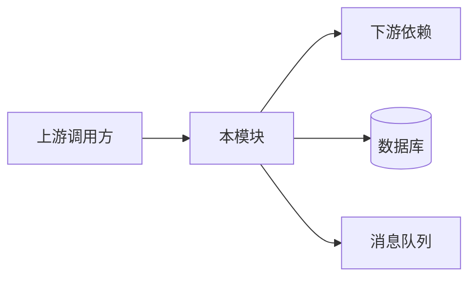
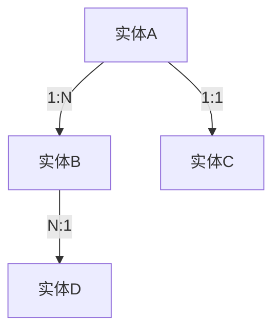

# SPEC-BE - 后端模块设计文档

> **文档编号**: SPEC-BE-[项目编号]-[序号]
> **版本**: v0.1
> **状态**: 草稿 | 评审中 | 已批准（三值由该步自检清单驱动：清单全过即写"已批准"，由产出方落盘时直接写，不等用户口令）
> **作者**: [姓名]
> **上游文档**: ARCH-[编号], PRD-[编号]
> **创建日期**: [YYYY-MM-DD]
> **最后更新**: [YYYY-MM-DD]

---

## 关联文档追溯

> 本文档的每个设计决策必须可追溯到上游需求，下游实现必须可追溯到本文档。

| 类别 | 文档 | 编号 | 说明 |
|------|------|------|------|
| 输入 | PRD（需求来源） | PRD-[编号] | 用户故事与验收标准 |
| 输入 | ARCH（架构设计） | ARCH-[编号] | 技术选型与分层约束 |
| 输出 | SPEC-API（API 契约） | SPEC-API-[编号] | 接口详细定义（OpenAPI YAML） |
| 输出 | SPEC-DDL（数据库设计） | SPEC-DDL-[编号] | 建表脚本 |
| 输出 | SPEC-TEST（测试计划） | SPEC-TEST-[编号] | 测试策略与用例 |

---

## 1. 架构位置

### 1.1 模块定位
<!-- 填写指引：本模块在整体架构中的位置和职责 -->

**模块名称**: [名称]
**所属服务**: [服务名]
**职责**: [一句话描述核心职责]

### 1.2 交互说明
<!-- 填写指引：与其他模块/服务的交互关系，含 ASCII 架构图 + 交互方表格 -->



| 交互方 | 协议 | 方向 | 用途 |
|--------|------|------|------|
| [调用方] | REST/gRPC | 入 | [说明] |
| [被调用方] | REST/gRPC/MQ | 出 | [说明] |
| [数据库] | TCP | 出 | 持久化 |
| [消息队列] | AMQP/Kafka | 出 | 异步事件 |

### 1.3 依赖关系
| 依赖方向 | 模块/服务 | 交互方式 | 说明 |
|---------|----------|---------|------|
| 被依赖 | [调用方] | REST/gRPC | [说明] |
| 依赖 | [被调用方] | REST/gRPC/MQ | [说明] |

---

## 2. 技术选型

### 2.1 本模块技术栈
<!-- 填写指引：继承ARCH选型，补充模块特有选择 -->

| 层面 | 技术 | 版本 | 选型理由 |
|------|------|------|---------|
| 语言 | [Go/Java/...] | [版本] | 继承ARCH |
| 框架 | [Gin/Spring/...] | [版本] | [理由] |
| ORM | [GORM/MyBatis/...] | [版本] | [理由] |
| 验证 | [validator/...] | [版本] | [理由] |
| 数据库 | [PostgreSQL/MySQL/...] | [版本] | 继承ARCH |
| 中间件 | [Redis/RabbitMQ/...] | [版本] | [理由] |

### 2.2 关键库
| 库 | 用途 | 版本 |
|----|------|------|
| [库名] | [用途] | [版本] |

### 2.3 工程结构
<!-- 填写指引：模块的代码目录组织，六边形架构/分层架构目录结构 -->

```
module-name/
├── cmd/                    # 入口
│   └── main.go
├── internal/
│   ├── handler/           # 接口层（Controller）
│   │   └── xxx_handler.go
│   ├── service/           # 业务逻辑层
│   │   └── xxx_service.go
│   ├── repository/        # 数据访问层
│   │   └── xxx_repo.go
│   ├── model/             # 领域模型
│   │   ├── entity/        # 实体
│   │   ├── dto/           # 数据传输对象
│   │   └── event/         # 领域事件
│   └── middleware/        # 中间件
├── api/                   # API定义（OpenAPI YAML）
│   └── openapi.yaml
├── migrations/            # 数据库迁移
├── config/                # 配置
└── tests/                 # 测试
```

### 2.4 分层规则
| 层 | 职责 | 可依赖 | 禁止依赖 |
|----|------|--------|---------|
| handler | 参数校验、协议转换 | service | repository, model内部 |
| service | 业务编排、事务管理 | repository, model | handler |
| repository | 数据持久化 | model | service, handler |
| model | 领域定义 | 无 | 其他所有层 |

---

## 3. 开发环境

### 3.1 本地开发环境
<!-- 填写指引：本地运行所需的依赖与版本 -->

| 依赖 | 版本 | 说明 |
|------|------|------|
| [运行时，如 Go/Java/Node] | [版本] | [说明] |
| [数据库，如 PostgreSQL] | [版本] | [说明] |
| [缓存，如 Redis] | [版本] | [说明] |
| [消息队列，如 RabbitMQ] | [版本] | [说明] |

**启动命令**: `[如 docker-compose up -d && go run cmd/main.go]`

### 3.2 联调环境
<!-- 填写指引：联调环境依赖配置 -->

| 依赖 | 版本 | 说明 |
|------|------|------|
| [依赖 1] | [版本] | [说明] |
| [依赖 2] | [版本] | [说明] |

**环境访问信息**:
- API 地址: `[联调环境 API 地址]`
- 数据库: `[连接信息]`
- 测试账号: `[账号信息]`

### 3.3 Mock 与环境切换
<!-- 填写指引：Mock 模式配置，便于独立开发与测试 -->

| 外部依赖 | Mock 方案 | 切换方式 |
|---------|----------|---------|
| [数据库] | [H2/SQLite/嵌入式] | profile: mock |
| [消息队列] | [in-memory 实现] | env: MQ_MODE=mock |
| [第三方服务] | [Mock Client] | feature flag |

---

## 4. 用例
<!-- 填写指引：从PRD用户故事映射到技术用例 -->

### 4.1 用例清单

| 用例ID | 名称 | 参与者 | 触发方式 | 关联US | 优先级 |
|--------|------|--------|---------|--------|--------|
| UC-001 | [用例名] | [角色] | HTTP/gRPC/MQ | US-001 | P0 |
| UC-002 | [用例名] | [角色] | HTTP/定时任务 | US-002 | P1 |

### 4.2 用例详情

#### UC-001: [用例名称]

**参与者**: [角色]
**前置条件**: [条件]
**触发方式**: [HTTP POST /api/v1/xxx]

**主流程**:
1. [步骤1]
2. [步骤2]
3. [步骤3]

**备选流程**:
- A1: [备选条件] → [处理方式]

**异常流程**:
- E1: [异常条件] → [处理方式]
- E2: [异常条件] → [处理方式]

**后置条件**: [结果状态]

---

## 5. 功能
<!-- 填写指引：模块功能列表与规则约束 -->

### 5.1 功能清单

| 功能ID | 功能名称 | 描述 | 关联用例 | 优先级 |
|--------|---------|------|---------|--------|
| F-001 | [功能名] | [一句话描述] | UC-001 | P0 |
| F-002 | [功能名] | [一句话描述] | UC-002 | P1 |

### 5.2 核心业务逻辑

**业务规则**:
| 规则ID | 描述 | 实现位置 | 关联功能 |
|--------|------|---------|---------|
| BR-001 | [规则描述] | [service层] | F-001 |

### 5.3 并发与一致性
<!-- 填写指引：并发控制、事务边界、最终一致性方案 -->

| 场景 | 策略 | 实现方式 |
|------|------|---------|
| [场景1] | 乐观锁/悲观锁 | [version字段/SELECT FOR UPDATE] |
| [场景2] | 最终一致性 | [本地消息表/Saga] |

### 5.4 幂等性设计

> 所有写操作（POST/PUT/DELETE）必须设计幂等性。特别是涉及支付、扣款、库存变更等关键操作。

| 接口 | 幂等策略 | 实现方式 | 过期时间 |
|------|---------|---------|----------|
| POST /api/v1/orders | 幂等键去重 | Idempotency-Key + 唯一索引 | 24h |
| POST /api/v1/payments | 唯一键去重 | request_id + 数据库唯一约束 | 48h |
| PUT /api/v1/orders/{id}/status | 状态机约束 | 仅允许合法状态转换 | N/A |

**幂等键传递方式**: 请求头 `Idempotency-Key: <uuid>`
**重复请求行为**: 返回首次请求的结果（HTTP 200），不重复执行业务逻辑

---

## 6. 术语
<!-- 填写指引：业务术语定义表，确保团队对领域概念理解一致 -->

| 术语 | 英文 | 定义 | 上下文 |
|------|------|------|--------|
| [术语 1] | [Term] | [定义] | [使用场景] |
| [术语 2] | [Term] | [定义] | [使用场景] |

---

## 7. 约束
<!-- 填写指引：约束项、规则、违规处理 -->

### 7.1 技术约束

| 约束项 | 规则 | 违规处理 | 来源 |
|--------|------|---------|------|
| [约束项 1] | [规则描述] | [违规后的处理方式] | ARCH/PRD |
| [约束项 2] | [规则描述] | [违规后的处理方式] | 安全合规 |

### 7.2 安全约束

| 安全项 | 要求 | 实现方式 |
|--------|------|---------|
| 敏感数据 | [加密/脱敏] | [实现方式] |
| 鉴权 | [接口鉴权策略] | [JWT/OAuth2/...] |
| 审计日志 | [重要操作记录] | [实现方式] |

### 7.3 性能约束

| 指标 | 目标值 | 降级策略 |
|------|--------|---------|
| P99 响应时间 | [≤Xms] | [详见 ARCH] |
| QPS | [≥X] | [详见 ARCH] |
| 可用性 | [99.X%] | [详见 ARCH] |

---

## 8. 领域实体
<!-- 填写指引：实体属性与行为方法 -->

### 8.1 实体关系图



### 8.2 实体定义

#### [实体名称]

| 字段 | 类型 | 约束 | 说明 |
|------|------|------|------|
| id | string(UUID) | PK | 主键 |
| name | string(128) | NOT NULL | 名称 |
| status | enum | NOT NULL | 状态 |
| created_at | datetime | NOT NULL | 创建时间 |
| updated_at | datetime | NOT NULL | 更新时间 |

**行为方法**:
| 方法 | 参数 | 返回值 | 业务规则 |
|------|------|--------|---------|
| [方法名] | [参数] | [返回] | [规则] |

**状态机**:
```
[初始] --创建--> [活跃] --完成--> [已结束]
                   |
                   +--取消--> [已取消]
```

---

## 9. API
<!-- 填写指引：方法、路径、请求/响应、错误码。详细定义见《API契约文档》(OpenAPI YAML) -->

### 9.1 API清单
| 方法 | 路径 | 描述 | 认证 | 限流 |
|------|------|------|------|------|
| POST | /api/v1/[resource] | 创建 | Bearer | 100/min |
| GET | /api/v1/[resource]/{id} | 查询 | Bearer | 500/min |
| PUT | /api/v1/[resource]/{id} | 更新 | Bearer | 100/min |
| DELETE | /api/v1/[resource]/{id} | 删除 | Bearer | 50/min |

### 9.2 API详情

#### POST /api/v1/[resource]

**请求**:
```json
{
  "field1": "string (required, max:128)",
  "field2": "integer (required, min:1, max:100)",
  "field3": "string (optional, enum: [a,b,c])"
}
```

**响应 201**:
```json
{
  "code": 0,
  "message": "success",
  "data": {
    "id": "uuid",
    "field1": "string",
    "created_at": "2024-01-01T00:00:00Z"
  }
}
```

### 9.3 错误码
> 🔴 本表是**示例形状**，不是码值来源。落盘时必须逐字取自本项目 **SPEC-API 契约**（错误码分段由 SPEC-API/ARCH 统一分配）；SPEC-API 若用字符串码或嵌套信封，本节跟随其形态，不得自造一套数字码与之并存。

| 错误码 | HTTP状态 | 描述 | 处理建议 |
|--------|---------|------|---------|
| 40001 | 400 | 参数校验失败 | 检查请求参数 |
| 40401 | 404 | 资源不存在 | 确认资源ID |
| 40901 | 409 | 资源冲突 | 重试或更新 |
| 50001 | 500 | 内部错误 | 联系运维 |

### 9.4 版本策略

- URL Path 版本号：如 `/v1/orders`、`/v2/orders`
- 向前兼容原则：新增字段不视为 breaking change
- 不兼容变更必须升大版本号
- 旧版本在生命周期内保持可用，文档中标注 deprecated 和下线时间

---

## 10. 事件
<!-- 填写指引：事件、生产者、消费者、触发条件、载荷 -->

### 10.1 领域事件清单
| 事件名 | 触发时机 | 生产者 | 消费者 | 投递保证 |
|--------|---------|--------|--------|---------|
| [Entity]Created | 实体创建后 | 本模块 | [消费方] | At-Least-Once |
| [Entity]Updated | 实体更新后 | 本模块 | [消费方] | At-Least-Once |

### 10.2 事件Schema

> 事件 Schema 遵循 CloudEvents 规范，确保跨系统互操作性。

#### [Entity]Created
```json
{
  "specversion": "1.0",
  "id": "uuid",
  "type": "com.module.entity.created",
  "source": "/module-name",
  "time": "2024-01-01T00:00:00Z",
  "datacontenttype": "application/json",
  "data": {
    "entity_id": "uuid",
    "field1": "value",
    "version": 1
  },
  "metadata": {
    "trace_id": "string",
    "operator": "string",
    "correlation_id": "string"
  }
}
```

### 10.3 消费规则

**幂等消费**: 消费者必须基于 `id` 字段做幂等处理，重复投递不产生副作用
**Schema 版本管理**: `data.version` 字段标识事件数据结构版本，消费者必须兼容多版本
**重试与死信**: 重试 3 次（间隔 10s、30s、60s），超限进入死信队列人工处理

---

## 11. 数据表
<!-- 填写指引：表名与说明。详细定义见DDL文件 -->

### 11.1 表清单

| 表名 | 说明 | 预估数据量 | 分表策略 |
|------|------|-----------|---------|
| [t_xxx] | [说明] | [初始/日增/年总] | [无需/按ID取模/按时间范围] |

### 11.2 表结构

#### 表: [table_name]

```sql
CREATE TABLE [table_name] (
    id          VARCHAR(36)   PRIMARY KEY,
    name        VARCHAR(128)  NOT NULL,
    status      VARCHAR(32)   NOT NULL DEFAULT 'active',
    config      JSONB,
    created_at  TIMESTAMP     NOT NULL DEFAULT CURRENT_TIMESTAMP,
    updated_at  TIMESTAMP     NOT NULL DEFAULT CURRENT_TIMESTAMP,
    deleted_at  TIMESTAMP     NULL,
    
    CONSTRAINT uk_name UNIQUE (name)
);

CREATE INDEX idx_status ON [table_name](status);
CREATE INDEX idx_created_at ON [table_name](created_at);
```

### 11.3 字段约定

| 约定项 | 规范 | 说明 |
|--------|------|------|
| 主键 | `VARCHAR(36)` UUID 或 `BIGINT` 自增 | 全局唯一 |
| 时间字段 | `created_at` / `updated_at` | 统一管理，自动填充 |
| 逻辑删除 | `deleted_at` TIMESTAMP NULL 或 `is_deleted` TINYINT(1) | 软删除标记 |
| 状态字段 | VARCHAR(32) + 枚举约束 | 状态机驱动 |
| 金额字段 | DECIMAL(12,2) | 精度要求 |
| 索引命名 | `idx_` 前缀（普通）/ `uk_` 前缀（唯一） | 规范统一 |

### 11.4 索引策略
| 表 | 索引名 | 列 | 类型 | 用途 |
|----|--------|-----|------|------|
| [表] | idx_xxx | [列] | B-Tree/GIN | [查询场景] |

### 11.5 数据量预估

> 数据量预估用于指导索引策略、分表方案和存储规划。

| 表 | 初始量 | 日增量 | 年总量 | 单行大小 | 年存储量 | 归档策略 |
|----|--------|--------|--------|---------|---------|---------|
| [表] | [X] | [X] | [X] | [X KB] | [X GB] | [按年/按月归档] |

### 11.6 缓存设计

| Key 格式 | 说明 | 过期时间 | 策略 |
|---------|------|---------|------|
| `[entity]:{id}` | [说明] | [X min] | 旁路缓存/Write-Through |

---

## 附录

### A. 配置项
| 配置键 | 默认值 | 说明 | 环境差异 |
|--------|--------|------|---------|
| [key] | [value] | [说明] | [dev/prod差异] |

### B. 变更记录
| 版本 | 日期 | 作者 | 变更内容 |
|------|------|------|---------|
| v0.1 | [日期] | [作者] | 初稿 |

---

## 质量检查清单

- [ ] 关联文档追溯完整（输入/输出文档编号对应）
- [ ] 架构位置清晰，交互方与协议明确
- [ ] 技术选型继承 ARCH，工程结构与分层规则一致
- [ ] 开发环境含 Mock 切换方案
- [ ] 每个用例有完整的参与者/前置/主流程/备选/异常/后置
- [ ] 功能清单覆盖所有用例，业务规则有明确实现位置
- [ ] 术语表覆盖领域核心概念
- [ ] 约束项含技术/安全/性能三类，违规处理明确
- [ ] 领域实体关系正确，含行为方法与状态机
- [ ] API 设计符合 RESTful 规范，错误码体系完整
- [ ] 事件设计考虑了幂等消费与重试策略
- [ ] 数据表有合理索引，字段约定统一
- [ ] 并发和一致性有明确策略
- [ ] 与 ARCH 文档技术选型一致
- [ ] 与 PRD 用户故事可追溯
