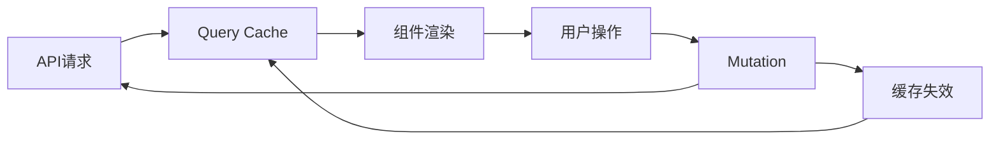
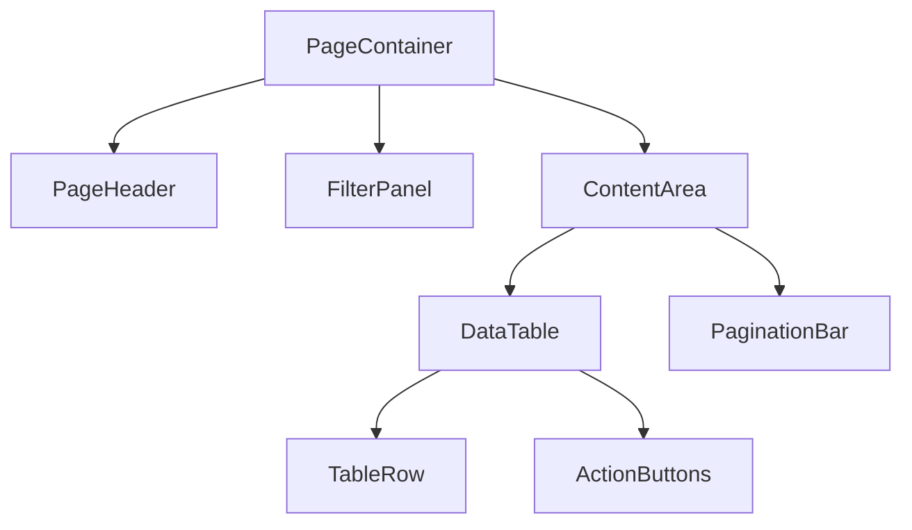

# SPEC-FE - 前端模块设计文档

> **文档编号**: SPEC-FE-[项目编号]-[序号]
> **版本**: v0.1
> **状态**: 草稿 | 评审中 | 已批准（三值由该步自检清单驱动：清单全过即写"已批准"，由产出方落盘时直接写，不等用户口令）
> **作者**: [姓名]
> **上游文档**: PRD-[编号], ARCH-[编号]
> **创建日期**: [YYYY-MM-DD]
> **最后更新**: [YYYY-MM-DD]

---

## 写作强约束：只写本业务独有决策

> **本文档只写本业务/本模块独有的前端决策。凡上游文档或其他 SPEC 已定义的内容，一律不重复，以「详见 {文档}§{章节}」前向引用。**

| 内容 | 归属文档 | 本文档写法 |
|------|---------|-----------|
| 色板/字阶/间距/圆角/阴影 Token、组件视觉变体、页面四态视觉、动效参数体系、响应式断点、A11Y 标准 | SPEC-UI | 只引用不复写（如「视觉规范详见 SPEC-UI §2-§7」） |
| 接口路径/请求响应 schema/错误码 | SPEC-API | 只写前端消费方式（缓存策略/映射/失效时机），不复写契约 |
| 技术栈选型、分层架构、跨模块约定 | ARCH | 只写与 ARCH 不同或 ARCH 未覆盖的本模块决策 + 理由 |
| 用户故事、交互流程、页面流转 | PRD Section4 | 只写页面实现映射（页面↔US↔API），不复述流程 |

**去重自检**（提交前逐项确认）：
- [ ] 全文无裸色值/字号/间距数值（视觉一律指向 SPEC-UI）
- [ ] 全文无 API 请求/响应 schema 复写（一律指向 SPEC-API）
- [ ] 每条技术决策均为本模块独有，且附「备选 + 理由」
- [ ] 与 SPEC-UI 冲突时：视觉以 SPEC-UI 为准，组件数据契约以本文为准，冲突走 ADR 决策

---

## 关联文档追溯

| 类别 | 文档 | 编号 | 说明 |
|------|------|------|------|
| 输入 | PRD（需求来源） | PRD-[编号] | 用户故事与交互流程（Section4） |
| 输入 | ARCH（架构设计） | ARCH-[编号] | 前端技术选型与架构约束 |
| 输入 | SPEC-API（API 契约） | SPEC-API-[编号] | 后端接口定义（本文档只引用不复写） |
| 输入 | SPEC-UI（UI 规范） | SPEC-UI-[编号] | 视觉规范与组件标准（环节 4 产出；本文档不重复视觉决策） |

---

## 1. 文档概览

### 1.1 模块职责与范围
<!-- 填写指引：一句话描述本前端模块职责；列出覆盖的页面范围与不做什么（边界） -->

### 1.2 页面清单

| 页面ID | 页面名称 | 路由 | 类型 | 关联US | 优先级 |
|--------|---------|------|------|--------|--------|
| PG-001 | [页面名] | /path | 列表/详情/表单/弹窗 | US-001 | P0 |
| PG-002 | [页面名] | /path/:id | 详情页 | US-002 | P0 |
| PG-003 | [页面名] | /path/create | 表单页 | US-003 | P1 |

### 1.3 页面-模块-US 映射表

> 确保每个 User Story 都有对应的页面实现，每个页面都有明确的需求来源。

| 页面 | 所属模块 | 关联 US | 关联 API | 状态 |
|------|---------|---------|---------|------|
| PG-001 列表页 | M-01 商品模块 | US-PROD-001, US-PROD-002 | GET /api/v1/products | ✅ 已设计 |
| PG-002 详情页 | M-01 商品模块 | US-PROD-003 | GET /api/v1/products/:id | ✅ 已设计 |
| PG-003 创建页 | M-02 订单模块 | US-ORD-001 | POST /api/v1/orders | ⏳ 待设计 |

### 1.4 设计输入引用

| 输入 | 路径 | 用途 |
|------|------|------|
| SPEC-UI | `docs/spec/SPEC-UI-{模块名}.md` | 视觉 Token 与组件规范唯一来源 |
| 设计工程（如有） | `references/ui/` | 环节 4 高保真设计工程，前端实现必须与其完全一致 |
| 交互原型工程 | `docs/prd/PRD-{应用}-交互原型/` | 页面结构与流转基准（环节 1·步骤 3 冻结） |

---

## 2. 架构约定（只写本模块独有）

### 2.1 技术决策
<!-- 填写指引：仅本模块特有的技术选择及理由；与 ARCH 全局选型一致的不写 -->

| 决策点 | 选择 | 备选 | 理由 |
|--------|------|------|------|
| 状态管理 | [Zustand/Redux/Pinia] | [其他] | [理由] |
| 数据请求 | [TanStack Query/SWR] | [其他] | [理由] |
| 表单方案 | [React Hook Form/Formik] | [其他] | [理由] |
| 样式方案 | [Tailwind/CSS Modules] | [其他] | [理由] |

### 2.2 状态管理分层

| 状态类型 | 管理方式 | 示例 |
|---------|---------|------|
| 服务端状态 | TanStack Query | 列表数据、详情数据 |
| 全局客户端状态 | Zustand/Redux | 用户信息、主题、权限 |
| 页面级状态 | useState/computed | 筛选条件、分页、排序 |
| 组件级状态 | useState/ref | 弹窗开关、表单输入 |
| URL状态 | Router params/search | 页面、搜索关键词 |

#### Store 设计（仅本模块 Store）
```typescript
interface StoreState {
  // 状态
  user: User | null;
  permissions: string[];
  
  // 操作
  setUser: (user: User) => void;
  hasPermission: (perm: string) => boolean;
  logout: () => void;
}
```

### 2.3 数据流与缓存策略



| 数据 | staleTime | gcTime | 失效时机 |
|------|-----------|--------|---------|
| 列表数据 | 30s | 5min | 增删改后 |
| 详情数据 | 60s | 10min | 编辑保存后 |
| 配置数据 | 5min | 30min | 手动刷新 |

### 2.4 API 层封装（只写消费方式，契约详见 SPEC-API）

```typescript
// api/[module].ts
export const moduleApi = {
  list: (params: ListParams) => 
    request.get<PaginatedResponse<Item>>('/api/v1/resource', { params }),
  detail: (id: string) => 
    request.get<Item>(`/api/v1/resource/${id}`),
  create: (data: CreateDTO) => 
    request.post<Item>('/api/v1/resource', data),
  update: (id: string, data: UpdateDTO) => 
    request.put<Item>(`/api/v1/resource/${id}`, data),
  delete: (id: string) => 
    request.delete(`/api/v1/resource/${id}`),
};
```

### 2.5 性能策略

| 策略 | 应用场景 | 实现方式 |
|------|---------|---------|
| 虚拟滚动 | 长列表(>100条) | [react-window/vue-virtual-scroller] |
| 代码分割 | 路由级别 | React.lazy + Suspense |
| 图片懒加载 | 图片列表 | IntersectionObserver |
| 请求缓存 | 频繁查询 | TanStack Query staleTime |
| 防抖/节流 | 搜索输入/滚动 | lodash debounce |

### 2.6 兼容性决策
| 项目 | 支持范围 | 理由 |
|------|---------|------|
| 浏览器 | Chrome 90+, Safari 15+, Firefox 90+ | [理由] |
| 分辨率 | 最小1280px，响应式到1920px | [理由] |
| 移动端 | [是/否] | [理由] |

---

## 3. 通用组件规格（本模块复用组件）

> 组件**视觉规范**（色彩/尺寸/状态样式）详见 SPEC-UI §3；本章只定义组件的**数据契约**（Props/状态/事件）与复用关系。

### 3.1 组件树
<!-- 填写指引：页面组件的层次结构 -->



### 3.2 组件清单

| 组件名 | 类型 | 复用级别 | 职责 | Props |
|--------|------|---------|------|-------|
| [ComponentA] | 业务组件 | 模块内 | [职责] | 见下方 |
| [ComponentB] | 通用组件 | 全局 | [职责] | 见下方 |

### 3.3 组件详情

#### [ComponentName]

**职责**: [单一职责描述]

**Props定义**:
```typescript
interface ComponentNameProps {
  /** 数据源 */
  data: DataType[];
  /** 加载状态 */
  loading?: boolean;
  /** 操作回调 */
  onAction: (id: string, action: ActionType) => void;
  /** 自定义类名 */
  className?: string;
}
```

**状态**:
| 状态 | 类型 | 初始值 | 说明 |
|------|------|--------|------|
| [state1] | [type] | [value] | [说明] |

**事件**:
| 事件名 | 触发时机 | 参数 | 说明 |
|--------|---------|------|------|
| onAction | 用户操作 | (id, action) | [说明] |

---

## 4. 页面详设

> 每页的**布局视觉与四态视觉表现**详见 SPEC-UI；本章只写页面职责、交互行为、接口依赖与异常处理等实现决策。

### 4.1 路由结构
<!-- 填写指引：完整的路由树 -->

```
/
├── /module
│   ├── /list              → PG-001 列表页
│   ├── /:id               → PG-002 详情页
│   ├── /create            → PG-003 创建页
│   └── /:id/edit          → PG-004 编辑页
└── /module/settings       → PG-005 设置页
```

### 4.2 页面权限
| 页面 | 所需角色 | 未授权行为 |
|------|---------|-----------|
| [页面] | [角色] | 重定向/隐藏/提示 |

### 4.3 PG-001: [页面名称]

**页面职责**: [一句话描述]

**布局结构**（骨架示意，视觉细节详见 SPEC-UI）:
```
┌─────────────────────────────────────┐
│ Header（面包屑 + 操作按钮）           │
├──────────┬──────────────────────────┤
│ Filter   │ Content Area             │
│ Panel    │ ┌──────────────────────┐ │
│          │ │ Table/List           │ │
│          │ │                      │ │
│          │ └──────────────────────┘ │
│          │ Pagination               │
└──────────┴──────────────────────────┘
```

**交互说明**:
| 交互 | 触发 | 行为 | 反馈 |
|------|------|------|------|
| 搜索 | 输入+回车/点击 | 调用API，更新列表 | Loading → 结果/空态 |
| 筛选 | 选择筛选项 | 重新请求 | 列表刷新 |
| 排序 | 点击表头 | 本地/远程排序 | 箭头指示 |
| 删除 | 点击删除 | 二次确认弹窗 → API | Toast提示 |

**接口依赖**（契约详见 SPEC-API）:
| 接口 | 方法 | 用途 | 缓存策略 |
|------|------|------|---------|
| /api/v1/[resource] | GET | 列表查询 | staleTime: 30s |
| /api/v1/[resource]/{id} | DELETE | 删除 | 无缓存，失效列表 |

**异常处理**:
| 异常 | 表现 | 处理方式 |
|------|------|---------|
| 网络错误 | 请求失败 | 错误提示 + 重试按钮 |
| 空数据 | 无结果 | 空态插画 + 引导操作 |
| 权限不足 | 403 | 无权限提示页 |

### 4.4 PG-002: [页面名称]
<!-- 同上结构重复 -->

---

## 5. 全局交互约定

> 动效参数体系、反馈时长、四态视觉表现等**通用交互规范详见 SPEC-UI §4-§5**；本章只写本模块独有的交互约定与错误码消费映射。

### 5.1 错误处理约定（前端消费视角）
| 错误类型 | 处理方式 | 用户反馈 |
|---------|---------|---------|
| 401 | 跳转登录 | Toast: 登录已过期 |
| 403 | 显示无权限 | 无权限页面 |
| 404 | 显示不存在 | 404页面 |
| 422 | 表单字段标红 | 字段级错误提示 |
| 500 | 通用错误 | Toast: 服务异常，请重试 |
| 网络断开 | 离线提示 | 全局Banner |

### 5.2 本模块独有交互约定
<!-- 填写指引：仅本模块特有的交互决策（如跨页面状态传递、特殊手势、离线队列等）；通用约定不写 -->

---

## 附录

### A. 设计资产链接
| 资产 | 路径/链接 | 备注 |
|------|----------|------|
| SPEC-UI | docs/spec/SPEC-UI-{模块名}.md | 视觉规范唯一来源 |
| 设计工程 | references/ui/ | 环节 4 产出（如有） |
| 风格取值来源 | [内置设计能力 / 既有设计系统 / 用户风格要求] | 注明决策出处 |

### B. 变更记录
| 版本 | 日期 | 作者 | 变更内容 |
|------|------|------|---------|
| v0.1 | [日期] | [作者] | 初稿 |

---

## 质量检查清单

- [ ] 页面清单完整，覆盖所有用户故事
- [ ] 每个页面有布局骨架和交互说明
- [ ] 组件职责单一，Props定义清晰
- [ ] 状态管理分层合理
- [ ] 异常处理覆盖网络错误、空态、权限
- [ ] 性能策略明确（长列表、代码分割等）
- [ ] 与PRD交互流程一致
- [ ] 与后端API契约对齐（引用而非复写）
- [ ] **去重达标**：无裸色值/字号/间距（视觉指向 SPEC-UI）、无 API schema 复写（指向 SPEC-API）、每条决策为本模块独有且附理由
