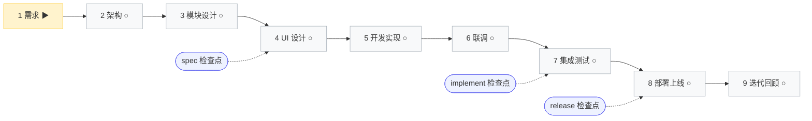

# PROJECT-LIVE — 项目开发指导中心

> 本文件是项目的**单一状态面**：SDD 全流程提示词手册 + 项目概况（交接面另见 docs/项目交接.md）。由 better-coding SKILL 在阶段 A 初始化，由 3 步同步持续自动维护。
>
> **阅读顺序**：第 0 区「SDD 全流程提示词手册」= 全流程一览（9 环节 × 22 步骤，每步一条整段可复制的提示词与人话扫读字段），复制任一步骤的提示词即可执行对应环节步骤；顶部进度表告诉你到哪了、下一步做什么；第 1 区为项目概况。**换会话或换话题前先读 [`项目交接.md`](项目交接.md)**。
> **刚初始化完，先做这件事**：让 Qoder 生成 **RepoWiki**（项目知识库），它会读懂已有的代码和文档，之后提问会准很多。想定制结构就让它写 `.qoder/repowiki/wiki_plan.yaml`——**改完必须重跑一次 wiki 构建才生效，平台不会定时再生**。
>
> **配套可视化**：[`PROJECT-LIVE.html`](PROJECT-LIVE.html)（落盘于仓库 `docs/`，文件树可见，浏览器双击直接打开）承载专业架构拓扑（节点含状态徽标：待开发/进行中/已完成/存在Bug）与技术栈详情，与本文件同源自动更新；显示滞后时执行 `/live-refresh` 手动刷新。
>

> **提示词来源**：本手册各步骤「提示词」代码框以 `.qoder/briefing-skeletons.md`（唯一基准）与静态壳为准，在构建期由工装 `tools/build-manual.mjs` 拼接后随阶段 A 落盘（该工装不随本库交付，项目内没有那个脚本：同步时按骨架逐字重渲对应区块并绑定参数，不重写正文），整段自包含——八个白话标签（这一步我要拿到 / 为什么要单独做 / 我能提供的材料 / 参考格式 / 请交付到 / 请按下面顺序做 / 红线（绝对不能做）/ 怎样算做完（请逐条打勾））与一条「做完之后」收尾行。只需替掉 `{占位}` 并粘贴执行；不要单独在本文件修改提示词正文（同步时按骨架整段重渲）。
>
> **文档路径约定**：需求 → `docs/prd/`（扁平，交互原型工程 `docs/prd/*-交互原型/`）｜架构 → `docs/arch/`（扁平，ADR 在 `docs/arch/adr/`）｜模块设计与测试 → `docs/spec/`（一功能一目录 `NNN-slug/`，NNN 三位递增编号；旧扁平文件 `SPEC-*.md` 继续有效，迁移自愿）｜UI 设计工程 → `references/ui/`。
>
> 随时输入 `/harness-next` 获取进度与下一步建议（与本文件手册同源）。

<!-- harness:section workflow managed-dynamic -->

## SDD 全流程提示词手册

**当前进度**：环节 1 需求（1/9）｜规模分诊：待需求声明后判定（≤5 文件 → `/quick-spec` 快速通道；常规 → 3 道检查点；中大型 → SDD 全链）｜依据：`maturity.prd=false`



> **怎么用**：找到当前进行中的步骤（🔄），复制其「提示词」代码框内容（替换 `{占位}` 后粘贴执行）。只有 1·1 需要你填写想法，其余步骤由 AI 根据前序产出自动绑定参数。每完成一步，下次同步自动回填后续步骤参数并刷新状态。
>
> **状态图例**：✅ 已完成｜🔄 进行中｜⬜ 待开始｜⏭️ 跳过
>
> **折叠渲染说明**：环节 5/9 为路径分叉环节，运行期按 /live-refresh 折叠渲染只展开选中路径，本模板为初态全量展示（22 步）。环节5：后端=5·2／前端=5·3／全栈=5·4；环节9：新功能=9·2／缺陷=9·3／重构=9·4，9·1 分诊与 9·5 收尾恒渲染。Backend-Only 应用环节 4 整体跳过（⏭️）。
>
> **不变式**：环节区块数 == 9（横切 Hooks 不占编号环节）；步骤区块数 == Σ各环节（选中路径/分支）步骤数（v9.0.0 全链 22 步：环节1=3／环节2=2／环节3=2／环节4=2／环节5=4／环节6=1／环节7=2／环节8=1／环节9=5）。

<details>
<summary>📖 名词与路径速查（第一次用手册，先看这块就够）</summary>

| 名词 | 一句话解释 | 落在哪里 | 哪个步骤产出 |
|------|-----------|----------|--------------|
| MRD | 市场需求文档：为什么做、为谁做、期望什么结果 | docs/prd/MRD-{项目代号}.md | 1·1 |
| PRD | 产品需求文档：一个应用一份，含用户故事与验收标准 | docs/prd/PRD-{应用}.md | 1·2 |
| 交互原型 | 可点击的页面工程，只用于评需求，不接真实接口 | docs/prd/PRD-{应用}-交互原型/ | 1·3 |
| ARCH | 架构设计：系统骨架、技术选型、部署与容量 | docs/arch/ARCH-{项目代号}.md | 2·1 |
| ADR | 架构决策记录：某项选型为什么这么定、备选是什么 | docs/arch/adr/ADR-*.md | 2·1 |
| 项目交接 | 下一次会话接着干要读的那份：目标、已完成（附证据）、已决策（含被否决方案）、下一步、关键文件 | docs/项目交接.md | 每步收尾 |
| 过关检查点 | 阶段收尾的硬关卡，共 3 关：设计定稿前 / 上线前测试过关 / 发布前 | 各环节标注 | 3·2／7·2／8·1 |
| 定稿锁定 | 定稿后再改要走变更申请，不能直接改文档 | MRD／PRD／ARCH 头部标记 | 1·2／2·2 |
| 六件套 | 模块级"照单施工"设计：后端 / 接口 / 建表 / 前端 / 测试 / 任务 | docs/spec/NNN-slug/ | 3·1 |
| SPEC-UI | 界面设计规范：色彩、字号、间距、组件、四态 | docs/spec/SPEC-UI-{模块名}.md | 4·1 |
| 设计工程 | 可运行的前端界面工程（页面真实样子） | references/ui/ | 4·1 |
| 联调记录 | 模块间接口真实调通的证据 | docs/spec/联调记录-{日期}.md | 6·1 |
| 测试计划 / 测试报告 | 测什么怎么测 / 结果与能不能上线 | docs/test/spec-{业务}-测试计划.md、docs/test/spec-{业务}-测试报告.md | 7·1 / 7·2 |
| 上线记录 | 每次部署的留痕，含可用的回滚命令 | docs/spec/上线记录-{日期}.md | 8·1 |
| 变更目录 | 迭代期一次变更的提案与规格增量 | docs/changes/{变更名}/ → 归档 docs/changes/archive/ | 9·2 |
| 三道过关检查点 | 硬关卡：spec（环节 1-3 收尾）、implement（环节 5-7）、release（环节 8） | 见各步骤「怎样算做完」段 | 各步骤收尾 |

> 每个步骤区块里的「提示词」代码框是唯一需要你复制的内容；代码框上方的四个字段供你扫读，不必复制。

</details>

---

### 进度表（一眼看到哪了、下一步做什么）

| 环节 | 步骤 | 状态 | 交付路径 | 下一步 |
|---|---|---|---|---|
| 1 | 1·1 | 🔄 进行中 | docs/prd/MRD-{项目代号}.md | 1·2 |
| 1 | 1·2 | ⬜ 待开始 | docs/prd/PRD-{应用}.md | 1·3／2·1 |
| 1 | 1·3 | ⬜ 待开始 | docs/prd/PRD-{应用}-交互原型/ | 2·1 |
| 2 | 2·1 | ⬜ 待开始 | docs/arch/ARCH-{项目代号}.md | 2·2 |
| 2 | 2·2 | ⬜ 待开始 | docs/arch/ 下的架构验证报告 | 3·1 |
| 3 | 3·1 | ⬜ 待开始 | docs/spec/{NNN}-{slug}/SPEC-API.yaml | 3·2 |
| 3 | 3·2 | ⬜ 待开始 | docs/spec/{NNN}-{slug}/ | 4·1／5·1 |
| 4 | 4·1 | ⬜ 待开始 | references/ui/ | 4·2 |
| 4 | 4·2 | ⬜ 待开始 | docs/spec/还原核对-{模块名}.md | 5·1 |
| 5 | 5·1 | ⬜ 待开始 | docs/项目交接.md | 5·2／5·3／5·4 |
| 5 | 5·2 | ⬜ 待开始 | 后端工程代码 | 6·1／5·4 |
| 5 | 5·3 | ⬜ 待开始 | {输出目录} | 6·1／5·4 |
| 5 | 5·4 | ⬜ 待开始 | 后端代码 | 6·1 |
| 6 | 6·1 | ⬜ 待开始 | 联调分支 | 7·1 |
| 7 | 7·1 | ⬜ 待开始 | docs/test/spec-{业务}-测试计划.md | 7·2 |
| 7 | 7·2 | ⬜ 待开始 | docs/test/spec-{业务}-测试报告.md | 8·1 |
| 8 | 8·1 | ⬜ 待开始 | {输出目录} | 9·1 |
| 9 | 9·1 | ⬜ 待开始 | docs/项目交接.md | 9·2／9·3／9·4 |
| 9 | 9·2 | ⬜ 待开始 | docs/changes/{change-name}/ | 9·5 |
| 9 | 9·3 | ⬜ 待开始 | 修复代码 | 9·5 |
| 9 | 9·4 | ⬜ 待开始 | 简化后的代码 | 9·5 |
| 9 | 9·5 | ⬜ 待开始 | docs/项目交接.md | 1·1 |

### 🔄 环节 1 · 需求 —— 把一句话想法变成结构化需求

**核心使命**：多步骤产出 MRD → 按应用多份 PRD（含风格要求采集）→ 交互原型工程；AI 只问不猜，共识达成前不产出

**本环节产出目录**：`docs/prd/`

<details>
<summary>📗 环节 1 做完你会拿到什么 · 怎么验</summary>

- **交付物**：docs/prd/MRD-{项目代号}.md、每个应用一份 docs/prd/PRD-{应用}.md、全栈应用的可点击原型工程 docs/prd/PRD-{应用}-交互原型/
- **看得见的进度信号**：文件树里出现上述文件；MRD 头部有定稿锁定标记与所用专家配置；带界面应用已给出风格要求与视觉方向
- **怎么验**：模糊用语 0 处、量化目标不少于 3 项；原型逐页能点开且页面数与 PRD 交互流程一致；纯后端应用不要求原型
- **卡住时**：关键分歧没裁定就回到 1·1 用选择卡问清；应用类型判不准回到 1·2 的分类矩阵

</details>

> **本环节建议**：想法很长时开一个新任务挂着跑；要求它**一次只问一个问题、每题必带推荐项**——拷问式澄清比直接生成文档更省返工。原型出来后务必亲自过一遍：让它截图给你看，别只看文件列表。

#### 🔄 1·1 说出你的想法，产出 MRD

**你要做的事**：一份多位专家并行分析后合并成的 MRD，关键争议先问我再动笔。

**你会拿到**：docs/prd/MRD-{项目代号}.md
**建议怎么用**：复制下面提示词到 Qoder 执行

**提示词**：
```text
/create-proposal 我有一个想法：{一句话想法}。先帮我做成一份 MRD
我有参考资料：无 ←有就把「无」换成文件路径（例：docs/竞品截图.png、references/调研笔记.md，多个用、隔开）；保持「无」就是本次不提供，别翻目录找文件充当我的输入（读项目代码核对事实不算）

这一步我要拿到：一份多位专家并行分析后合并成的 MRD，关键争议先问我再动笔。

为什么要单独做：跳过就直接写 PRD，模糊口径会一路带到上线。

请分配 6 位专家（这是默认名单不是配额：先按上面这句话判断项目形态，再给我 2-3 种分配方案让我挑，3-6 位、至少含产品与架构，表外角色可临时加一位并标「待确认」）；主 Agent 任项目经理（分配、讨论、收敛），我选定后才派遣，其余每位独立并行交结论：
- 产品专家：用户价值、目标量化、功能优先级、MVP 边界 → 战略陈述、用户画像、做/不做清单
- 架构专家：系统边界、依赖可行性、实现风险与成本量级（只判能不能做，不出选型方案与模块拆分）→ 应用拆分建议、能力域与依赖契约草案、高风险需求清单
- 业务专家：规则完整性、异常覆盖、模型闭环 → 业务规则条目与异常分支清单
- 运营专家：运营抓手、指标体系、增长与成本 → ≥3 项量化目标（指标/基线/目标值）
- 安全专家：合规、数据安全、支付安全、攻击面 → 合规约束、敏感数据范围与风险等级
- 测试专家：可测性、验收标准、端到端场景与边界 → ≥5 个端到端验收场景

我能提供的材料：
- 参考资料：见开头「我有参考资料」那行，写着「无」就是本次不提供
参考格式：docs/harness-templates/MRD-template.md

请交付到：
- docs/prd/MRD-{项目代号}.md —— 8 章：背景、目标用户、量化指标、MVP 范围、依赖契约
- docs/项目交接.md —— 应用分类结论（新术语另登词汇本）

请按下面顺序做，每步做完给我看一眼再继续：
1)判断这个项目大概是什么形态，给我 2-3 种专家分配方案（每种：几位、每位关注点 → 要交的结论、为什么适配，标推荐项）；同一轮用选择卡一并问我项目代号（它要进文件名，给 2-3 个候选让我挑）
2)按我选定的名单派遣，每位独立并行交结论
3)把想法拆成谁用、解决什么、成功长什么样，指标写成数字
4)按应用维度列产品组合，逐个标纯后端还是全栈
5)能力域先定提供方，使用方只引用且名称一字不差
6)其余分歧用选择卡问我：每题至少 2 个候选并标推荐项
7)砍到本期最小可用：上面「怎样算做完」全部打勾就算定稿锁定，我不点头也算，我要改会直接说、你改完重新定稿重新同步；没拿到我的下一步指令前不要擅自开始 1·2

红线（绝对不能做）：
- 名单没经我选定前不派遣；派遣给每位的产出重心照我选定方案里写明的措辞，不许派出去再暗改
- 项目代号要先问我要；我说「你来起」才算授权，不能不问就写进文件名
- 不写模块拆分、架构分层、技术选型与接口字段设计
- 不写性能数字（P99/QPS/SLA），要提就写“详见 ARCH”
- 确认下来的业务术语要登记进项目词汇本
- 多应用只合并一份 MRD，不按应用各写一份

怎样算做完（请逐条打勾）：
- [ ] 8 章节齐全
- [ ] 量化业务目标不少于 3 项
- [ ] 目标用户不少于 2 类带画像
- [ ] 端到端场景不少于 5 个
- [ ] 模糊用语 0 处
- [ ] 关键分歧全部由我裁定过
- [ ] 多应用合并一份 MRD
- [ ] MRD 头部注明实际用的专家名单与理由、经我确认的项目代号

做完之后：执行 3 步同步，告诉我 MRD 路径与下一步「1·2 拆 PRD」。
```

#### ⬜ 1·2 把 MRD 拆成每个应用一份 PRD

**你要做的事**：每个应用一份能照着施工的需求文档，全栈应用顺带把设计稿依据问清楚。

**你会拿到**：docs/prd/PRD-{应用}.md
**建议怎么用**：复制下面提示词到 Qoder 执行

**提示词**：
```text
/create-proposal 按已定稿锁定的 MRD，一个应用拆一份 PRD

这一步我要拿到：每个应用一份能照着施工的需求文档，全栈应用顺带把设计稿依据问清楚。

为什么要单独做：不拆开就没有能照着施工的需求；混写多应用会让故事编号撞号、验收口径互相打架。

我能提供的材料：
- 已定稿锁定的 MRD：docs/prd/MRD-{项目代号}.md（按「产品组合与应用分类」章逐个出 PRD）
- 风格与品牌约束（可选）：一句话风格要求、既有组件库或设计系统文档路径
- 前序产出：{MRD路径}（缺哪份先问我，别猜）
- 本轮应用清单：{应用清单}（名称逐个照抄 MRD 应用维度章，不在此复述分类与结论）
参考格式：docs/harness-templates/PRD-template.md

请交付到：
- docs/prd/PRD-{应用}.md —— 每应用一份：功能列表、模块、用户故事与验收标准
- docs/项目交接.md —— 设计稿依据三问的答案（记在「已决策」）

请按下面顺序做，每步做完给我看一眼再继续：
1)先给我看应用分类与产出矩阵（各应用纯后端还是全栈、各交哪几章）再开工
2)用户故事编号带应用前缀，例如 US-CHM-001，跨应用不重复
3)全栈补齐「交互流程」章（页面清单、路由、异常分支），纯后端整章跳过
4)性能、容量、接口字段处一律写“详见 ARCH”，本步不给数值
5)没给过设计稿依据的全栈应用，问完把答案记进项目状态供后面复用
6)“本期不做”的边界写明，否则后面会被当成漏需求

红线（绝对不能做）：
- PRD 只写要做什么、给谁用、怎么算做完
- 禁止技术选型、部署方案、接口字段与性能数字
- 本步不拍板 UI 路线，只把设计稿依据问清楚记下来
- 一个应用只能一份 PRD，不按文档拆

怎样算做完（请逐条打勾）：
- [ ] 每个应用一份 PRD 且顶部应用类型标注正确
- [ ] 每模块不少于 3 个用户故事
- [ ] 每条用户故事不少于 2 条 Given-When-Then 验收标准
- [ ] 用户故事编号全局唯一
- [ ] 能力名称在提供方与使用方两侧一字不差
- [ ] 性能与容量数字 0 处（全部“详见 ARCH”）
- [ ] 全栈应用的交互流程章节齐全且页面清单可与原型一一对应
- [ ] 我确认过的设计稿依据已记录

做完之后：执行 3 步同步；全栈应用进「1·3 交互原型」，纯后端直接进「2·1 架构设计」。
```

#### ⬜ 1·3 交互原型工程(仅带界面应用)

**你要做的事**：一套能点开走的交互原型工程，写代码之前先把页面清单与跳转流程定下来。

**你会拿到**：docs/prd/PRD-{应用}-交互原型/
**建议怎么用**：复制下面提示词到 Qoder 执行

**提示词**：
```text
/ui-design 把 PRD 第 4 章的交互流程做成能点开走的原型工程

这一步我要拿到：一套能点开走的交互原型工程，写代码之前先把页面清单与跳转流程定下来。

为什么要单独做：页面和流程在纸上说清楚了不算数；能点开走一遍，模糊处会自己冒出来，改原型比改代码便宜一个数量级。

我能提供的材料：
- PRD：docs/prd/PRD-{应用}.md 第 4 章（交互流程与页面清单）
- 应用分类结论：{应用清单}（全栈还是纯后端以 MRD 应用维度章为准，本步只做带界面的应用）
- 参考格式：docs/harness-templates/PRD-template.md

请交付到：
- docs/prd/PRD-{应用}-交互原型/ —— 可运行工程：源码、依赖清单、启动方式说明
- docs/prd/PRD-{应用}-交互原型/预览.html —— 单文件预览，CSS/JS/假数据全部内联
- 打开方式：只双击 预览.html（index.html 与 dist/ 需 npm run dev，直接双击会白屏）

请按下面顺序做，每步做完给我看一眼再继续：
1)按 PRD 第 4 章列出页面清单与跳转关系，页面数要和清单严格 1:1
2)搭工程骨架并全部先用假数据，不接真实接口
3)逐页做出来，每页能点开、异常分支也能走到；图标用真 SVG，别拿 Unicode 字符顶替
4)额外产出 预览.html：不引 CDN、不 import 外部文件、不发任何网络请求
5)本地跑一遍构建、类型检查、lint，把结果报给我
6)问我流程和页面就是这些了吗——这一问答完就把原型工程定稿落盘并执行 3 步同步，不再另外等我一句"可以定稿"

红线（绝对不能做）：
- 只交一个单独的 HTML 文件当原型（看不出页面结构与跳转关系）
- 预览.html 引用 CDN 或外部资源，离线双击就会白屏
- 接真实后端接口或真实数据；敏感值一律走环境变量
- 没经我确认就进入环节 2

怎样算做完（请逐条打勾）：
- [ ] 构建、类型检查、lint 三项 0 错
- [ ] 路由数与 PRD 第 4 章页面清单数量一致且逐页可点开
- [ ] 核心流程能完整走通、异常分支可触达
- [ ] 不是一个单独的 HTML 文件
- [ ] 图标是真 SVG（不是 Unicode 字符），字阶与间距各有 4 档以上
- [ ] 我看过 3 张截图并点头：首屏没有大片空白、按钮分主次、调试条和产品 UI 看得出是两回事

做完之后：执行 3 步同步；纯后台应用本步跳过（⏭️）→ 下一步「2·1 架构设计三合一」。
```

### ⬜ 环节 2 · 架构 —— 定系统骨架并定稿锁定

**核心使命**：架构设计三合一（C4 双图 + 选型 ADR + 部署容量）→ 找茬小组纠察与定稿锁定；每项选型 ≥2 备选对比，关键决策 ADR 留痕

**本环节产出目录**：`docs/arch/`

<details>
<summary>📗 环节 2 做完你会拿到什么 · 怎么验</summary>

- **交付物**：docs/arch/ARCH-{项目代号}.md（含 C4 容器级图、选型、部署与容量、外部集成、非功能指标表）+ docs/arch/adr/ADR-*.md 不少于 2 篇 + 架构验证报告与定稿锁定版
- **看得见的进度信号**：架构图有真实节点与连线（不再是空图）；三类非功能指标都带数字；ARCH 标注定稿锁定版本
- **怎么验**：每项选型都有不少于 2 个候选对比；找茬小组发现的严重问题全部闭环；模块间依赖矩阵（含共享结构归属、错误码分段、事件归属）齐备
- **卡住时**：技术栈还没定 → 先声明或执行 /harness-assemble；容量数字与需求对不上 → 回到 1·1 补量化目标

</details>

> **本环节建议**：用**计划模式**先出方案再动手；架构结论必须写进 `docs/arch/`，别只留在聊天记录里——聊天记录不是交付物。

#### ⬜ 2·1 架构设计三合一（C4 双图+选型 ADR+部署容量）

**你要做的事**：一份能照着开工的架构文档，系统骨架、选型理由、部署与容量一次说清。

**你会拿到**：docs/arch/ARCH-{项目代号}.md
**建议怎么用**：复制下面提示词到 Qoder 执行

**提示词**：
```text
/create-architecture 出一份能照着开工的架构设计（系统骨架 + 选型留痕 + 部署容量）

这一步我要拿到：一份能照着开工的架构文档，系统骨架、选型理由、部署与容量一次说清。

为什么要单独做：不先定架构就开发，容量与性能全靠拍脑袋，撑不住峰值时要回头改接口和数据表。

我能提供的材料：
- 需求来源：docs/prd/PRD-{应用}.md（架构要能追溯到具体章节）
- 量化指标：docs/prd/MRD-{项目代号}.md（容量数字的出处）
- 候选技术栈：AGENTS.md（未定就先声明或跑 /harness-assemble）
- 环境与合规约束：docs/项目交接.md（可选）
- 前序产出：{MRD路径}、{PRD路径}、{候选技术栈}（缺哪份先问我，别猜）
参考格式：docs/harness-templates/ARCH-template.md

请交付到：
- docs/arch/ARCH-{项目代号}.md —— 骨架图、集成清单、选型对比、容量基线
- docs/arch/adr/ADR-*.md —— 关键决策不少于 2 篇，每篇含背景与后果

请按下面顺序做，每步做完给我看一眼再继续：
1)先画系统骨架：核心业务域、外部系统边界、集成点与通信协议
2)图用 Mermaid，至少到 C4 容器层，不下探实现细节
3)性能、可用性、容量三类指标写成数字，并标依据来自哪一条
4)每项选型至少 2 个候选，比对性能、生态、团队熟悉度与运维成本
5)重要选型各配一篇决策留痕，禁止只写“用了什么”不给理由
6)全栈应用补前端架构与前后端通信方式，中间件逐项给理由
7)最后给部署拓扑、容量基线、限流降级策略与回滚方案

红线（绝对不能做）：
- 架构层不写市场需求与功能优先级
- 容量数字必须能追溯到 MRD/PRD 的量化指标，不能凭空给
- 至少标出 3 个高风险决策点并说明缓解手段
- 不画到实现细节，也不在本步定线程模型与部署脚本

怎样算做完（请逐条打勾）：
- [ ] 三类非功能指标全部量化
- [ ] 外部集成清单完整
- [ ] 至少 3 个高风险决策点
- [ ] 每项选型都有不少于 2 个候选对比
- [ ] 不少于 2 篇 ADR 且含替代方案与后果
- [ ] 容量与 MRD/PRD 量化指标一一对应
- [ ] 部署方案含环境/拓扑/容量/回滚
- [ ] C4 图至少到容器层且未下探实现细节

做完之后：执行 3 步同步；下一步「2·2 质量验证与架构定稿锁定」。
```

#### ⬜ 2·2 质量验证+找茬小组+定稿锁定

**你要做的事**：9 项检查点逐项有结论、刺已挑完并修到闭环的架构，签批定稿锁定后成为唯一上游。

**你会拿到**：docs/arch/ 下的架构验证报告
**建议怎么用**：复制下面提示词到 Qoder 执行

**提示词**：
```text
/create-architecture 给这份架构跑质量检查点、找人挑完刺，再签批定稿锁定

这一步我要拿到：9 项检查点逐项有结论、刺已挑完并修到闭环的架构，签批定稿锁定后成为唯一上游。

为什么要单独做：没过检查点就定稿锁定，后面每个环节都以这份架构为准，一处口径错会一路带到上线再返工。

我能提供的材料：
- 待验架构：docs/arch/ARCH-{项目代号}.md（含选型、部署与容量章节）
- 决策留痕：docs/arch/adr/ADR-*.md（背景、决策、后果）
- 前序产出：{ARCH路径}（缺哪份先问我，别猜）
参考格式：docs/harness-templates/ARCH-template.md（核对章节是否齐备）

请交付到：
- docs/arch/ 下的架构验证报告 —— 检查点结论与逐条编号的发现清单
- docs/arch/ARCH-{项目代号}.md —— 定稿锁定版，含签批留痕与版本号

请按下面顺序做，每步做完给我看一眼再继续：
1)先跑 9 项质量检查点，逐项给通过或不通过，不许写“基本没问题”
2)三位独立评审各挑架构决策与容量假设，结论逐条带编号
3)严重发现必须修完；要你接受风险的逐条用选择卡问我。无论哪种，ARCH 照落盘、照执行 3 步同步，未闭环项写进 ARCH 头部状态行与 profile 事件记录（定稿不等于无风险，风险要看得见）
4)修完重跑一遍检查点，全部有结论才继续
5)多应用场景比对各应用架构有没有矛盾，例如同一能力两处定义
6)定稿锁定时留签批痕迹与版本号，定稿锁定后的改动要走变更流程

红线（绝对不能做）：
- 挑刺只针对这份架构，不顺手改需求
- 由 AI 给出的挑刺结论必须标注“待核验”
- 定稿锁定后的架构是唯一上游，别处不再补写架构决策
- 没有编号与处置结果的发现不算闭环

怎样算做完（请逐条打勾）：
- [ ] 9 项检查点全部有结论且无未闭环的严重项
- [ ] 找茬小组三方视角结论齐备并逐条有处置结果
- [ ] 多个应用之间的一致性 0 矛盾
- [ ] 数据模型概要与模块间依赖矩阵（含共享数据结构归属、错误码分段、事件归属）齐备
- [ ] 定稿锁定签批与版本留痕可查

做完之后：执行 3 步同步；下一步「3·1 按依赖拓扑分批生成模块设计六件套」。
```

### ⬜ 环节 3 · 模块设计 —— 模块级照单施工设计 + 统一校验

**核心使命**：按依赖拓扑分批产出六件套（批内无依赖并行，Provider 先行）+ 统一一致性校验三合一（模块内/完备性/模块间）；spec 主检查点收尾

**本环节产出目录**：`docs/spec/{NNN}-{slug}/`

<details>
<summary>📗 环节 3 做完你会拿到什么 · 怎么验</summary>

- **交付物**：每个模块一个目录 docs/spec/NNN-slug/，内含 SPEC-BE.md、SPEC-API.yaml、SPEC-DDL.sql、SPEC-FE.md、SPEC-TEST.md、tasks.md
- **看得见的进度信号**：模块目录逐个出现；接口契约先于实现定稿锁定；一致性校验记录三段齐备
- **怎么验**：接口在提供方与使用方两侧零差异；建表语句能直接执行；任务清单每项可独立实现与验证
- **卡住时**：架构缺依赖矩阵 → 回 2·2 补；发现设计写到了实现细节 → 移除或下沉（这是 spec 主检查点的关键判据）

</details>

> **本环节建议**：**新开一个对话再做校验**，"换个人看"才挑得出毛病（这就是并行子任务的用武之地）；每份文档打开确认路径没错。

#### ⬜ 3·1 按依赖拓扑分批生成模块设计六件套

**你要做的事**：每个模块一套能照单施工的设计，接口契约先定稿锁定、建表语句能直接跑，同批并行出

**你会拿到**：docs/spec/{NNN}-{slug}/SPEC-API.yaml
**建议怎么用**：复制下面提示词到 Qoder 执行

**提示词**：
```text
/create-module-spec 按依赖顺序分批，一个模块一套设计六件套

这一步我要拿到：每个模块一套能照单施工的设计，接口契约先定稿锁定、建表语句能直接跑，同批并行出

为什么要单独做：跳过它就直接写代码，接口和表结构要到联调才对得上，返工铺满后端。

我能提供的材料：
- 架构文档：docs/arch/ARCH-{项目代号}.md（模块划分与依赖矩阵）
- 产品文档：docs/prd/PRD-{应用}.md（用户故事与验收标准）
- 已有产出：docs/spec/ 下已存在的模块目录（续编号用）
- 前序产出：{模块清单}、{ARCH路径}、{PRD路径}（缺哪份先问我，别猜）
参考格式：docs/harness-templates/ 下 SPEC 与 task 六份模板

请交付到：
- docs/spec/{NNN}-{slug}/SPEC-API.yaml —— 机器可读接口契约
- docs/spec/{NNN}-{slug}/SPEC-DDL.sql —— 可执行建表语句
- docs/spec/{NNN}-{slug}/SPEC-BE.md、SPEC-FE.md —— 前后端设计
- docs/spec/{NNN}-{slug}/SPEC-TEST.md、tasks.md —— 测试与任务清单
- server|web/<模块>/deps.yaml —— 接口版本登记，环节 6 比对用

请按下面顺序做，每步做完给我看一眼再继续：
1)按架构依赖矩阵把模块分层排队，同批内模块互不依赖
2)提供方先出接口契约并定稿锁定，使用方只引用锁定版；版本按模板逐模块登记进 deps.yaml
3)同批模块并行产出六件套；单模块失败只重跑该模块，不牵连同批其他
4)每个接口写清路径、方法、请求响应、错误码与示例，测试工具能直接读
5)建表语句的字段、索引、约束与后端设计里的数据模型一一对应
6)默认一批一次；模块超 5 个或批内仍强耦合时按依赖子图拆成多批

红线（绝对不能做）：
- 只做设计到能照单施工，不写实现代码
- 属于架构或实现阶段的约束要移除或标注下沉
- 模块清单由我从架构文档推导，与我的划分不一致请先改完再开工

怎样算做完（请逐条打勾）：
- [ ] 每个接口都有路径/方法/请求响应/错误码/示例
- [ ] 异常场景四类覆盖
- [ ] 测试计划含正常/异常/边界
- [ ] 任务清单含优先级与依赖且每项可独立完成
- [ ] 提供方声明的接口与使用方消费的完全对称
- [ ] 六件套文件命名与目录位置符合上面的路径

做完之后：执行 3 步同步；全部批次做完进入「3·2 统一一致性校验」。
```

#### ⬜ 3·2 统一一致性校验（模块内+完备性+模块间）

**你要做的事**：模块内漂移、完备性、模块间对称三道校验一次出结论，作为进后续环节的关口

**你会拿到**：docs/spec/{NNN}-{slug}/
**建议怎么用**：复制下面提示词到 Qoder 执行

**提示词**：
```text
/create-module-spec 模块内、完备性、模块间三道一致性校验一次跑完

这一步我要拿到：模块内漂移、完备性、模块间对称三道校验一次出结论，作为进后续环节的关口

为什么要单独做：不校就带着接口不对称和故事漏检进编码，两侧各写各的，要到联调才暴露。

我能提供的材料：
- 架构文档：docs/arch/ARCH-{项目代号}.md
- 产品文档：docs/prd/PRD-{应用}.md
- 待校模块：docs/spec/ 下已产出六件套的模块目录
- 前序产出：{ARCH路径}、{PRD路径}、{模块清单}（缺哪份先问我，别猜）

请交付到：
- docs/spec/{NNN}-{slug}/ —— 各模块就地修完留下的修订记录
- docs/spec/ 一致性校验记录 —— 模块内／完备性／模块间三段逐条附结论

请按下面顺序做，每步做完给我看一眼再继续：
1)先校模块内：用户故事、技术栈版本与 PRD/ARCH 逐项比对，不许漂移
2)属于实现阶段或架构阶段的内容，从设计文档里移除或标注下沉
3)再请开发、测试两位评审独立判断六件套够不够指导后续落地
4)最后校模块之间：提供方声明与使用方消费的接口字段结构零差异
5)共享数据结构与枚举只留一个定义处，错误码不撞号，事件两端结构一致
6)分两遍跑：产出时随手对一遍，全部完成后整体再对一遍；漂移修完重校

红线（绝对不能做）：
- 这一步只校文档之间的一致性，不改需求本身
- 需求确有问题回环节 1 走变更，不在设计文档里悄悄改口径
- 三道校验未通过前，不要开始后面的界面与开发步骤

怎样算做完（请逐条打勾）：
- [ ] 三道校验结论齐备且偏差 0
- [ ] 每条用户故事的验收标准都能找到对应测试场景
- [ ] 接口在提供方与使用方两侧零差异
- [ ] 共享数据结构与枚举单点定义
- [ ] 错误码无撞号
- [ ] 模块引用无环
- [ ] 越界设计已移除或下沉
- [ ] 有修订的模块已重新校验通过

做完之后：执行 3 步同步；环节 1 到 3 全通过才放行进 4·1（有界面）或 5·1（纯后端）。
```

### ⬜ 环节 4 · UI 设计 —— 编码前定稿锁定界面结构与交互

**核心使命**：4·1 一次定稿（设计计划三项确认 → 首页面打样 → 并行铺开其余页面 → SPEC-UI 与 references/ui/ 落盘 → G2 验收）→ 4·2 逐页还原核对并建立 G3 基准；最高优先级 Guardrail：用户提供设计工程时，前端实现必须与设计工程完全一致，不得以任何理由偏离；纯后端项目整体跳过（⏭️）

**本环节产出目录**：`references/ui/` 设计工程 + `docs/spec/`（SPEC-UI 与还原核对结论）

<details>
<summary>📗 环节 4 做完你会拿到什么 · 怎么验</summary>

- **交付物**：docs/spec/SPEC-UI-{模块名}.md、references/ui/ 设计工程、docs/spec/还原核对-{模块名}.md（G3 基准）
- **看得见的进度信号**：设计工程能本地起服务（npm install 后 npm run dev），浏览器可逐页点开
- **怎么验**：构建三检 0 错（npm run build、tsc --noEmit、lint）；路由数与 PRD 第 4 章页面清单 1:1；严重与重要视觉问题清零、视觉相似度 ≥90
- **卡住时**：内置设计能力不可用 → 降级为纯 SPEC-UI 文档流程并标注待补项；纯后端应用整环节跳过

</details>

> **本环节建议**：单路线，无需选工具——给它风格要求即可，不接 Figma、不收参考图。定稿前务必过 **G2**：用浏览器逐页截图看，或双击 `预览.html`。G2 通过后说一声「UI 定稿」，此后改动走变更申请。

#### ⬜ 4·1 UI 设计与定稿(G2 验收卡)

**你要做的事**：一套定稿的界面设计，色彩、字号、间距、组件、四态都有书面取值，附可点的界面工程与设计规范文档。

**你会拿到**：references/ui/
**建议怎么用**：复制下面提示词到 Qoder 执行

**提示词**：
```text
/ui-design 设计出一整套界面并定稿，定稿前过 G2 验收卡

这一步我要拿到：一套定稿的界面设计，色彩、字号、间距、组件、四态都有书面取值，附可点的界面工程与设计规范文档。

为什么要单独做：没定稿就开始实现，每个页面各写一套样式，返工时没有以哪份为准的依据；定稿也防止开发阶段顺手改设计。

我能提供的材料：
- 交互原型工程：docs/prd/PRD-{应用}-交互原型/（环节 1·3 产物，必须先就位）
- PRD：docs/prd/PRD-{应用}.md 第 4 章（页面清单与交互流程）
- 设计依据：{设计依据}（品牌色、既有组件库、禁忌项；没有就先问我）

请交付到：
- references/ui/ —— 前端设计工程，能起本地服务、逐页可点
- docs/spec/SPEC-UI-{模块名}.md —— 设计规范：色彩、字号、间距、组件清单、四态、响应式断点
- docs/项目交接.md —— G2 通过记录（含截图证据路径，不写已完成的字样）

请按下面顺序做，每步做完给我看一眼再继续：
1)先交设计计划：色彩方案、组件粒度、页面覆盖范围三项，等我确认再动手
2)按已确认的计划出首页面，本地起服务给我点开看
3)首页面通过后并行铺开其余页面，逐页核对与 PRD 页面清单 1:1
4)写 SPEC-UI：色彩、字号、间距、组件、四态、断点逐项有据可查
5)不确定处用选择卡问我，每题给候选和推荐，别替我决定
6)跑构建、类型检查、lint 三项并给出结果
7)G2 验收卡逐项取值齐备即算定稿并执行 3 步同步；开始环节 5 要等我给下一步指令

红线（绝对不能做）：
- 设计计划没经我确认就开始铺其余页面
- SPEC-UI 里写业务逻辑与数据模型（那是环节 3 的事）
- 定稿之后在本环节顺手改设计（要走变更申请）
- 用美观、现代感这类无法核对的词替代具体取值

怎样算做完（请逐条打勾）：
- [ ] 输入文件路径全部可访问
- [ ] 设计计划的三项（色彩方案/组件粒度/页面覆盖）我都确认过
- [ ] references/ui/ 能起本地服务且逐页可点
- [ ] SPEC-UI 六个系统章节齐备且与工程一致
- [ ] 类型检查、lint、构建三项 0 错
- [ ] 响应式在各断点不破版
- [ ] 我的视觉判断已通过
- [ ] 产物路径命名符合规范
- [ ] 不确定处用选择卡问了我，没有替我决定

做完之后：执行 3 步同步并登记 G2 通过记录（带截图证据路径）→ 下一步「4·2 还原核对与归档」。
```

#### ⬜ 4·2 还原核对与归档(G3 基准建立)

**你要做的事**：一份逐页还原核对结论与归档结果，立起后续每改一个页面都要过的还原基准（G3）。

**你会拿到**：docs/spec/还原核对-{模块名}.md
**建议怎么用**：复制下面提示词到 Qoder 执行

**提示词**：
```text
/ui-design 逐页核对实现与定稿设计的差异，归档并立 G3 基准

这一步我要拿到：一份逐页还原核对结论与归档结果，立起后续每改一个页面都要过的还原基准（G3）。

为什么要单独做：设计定稿与实现长得像定稿是两件事；缺这一步，环节 5 的页面没人对设计负责，走样到上线前才暴露。

我能提供的材料：
- 设计工程：references/ui/（4·1 定稿产物）
- 设计规范：docs/spec/SPEC-UI-{模块名}.md
- 实现代码：{前端工程路径}（先做 5·1-5·3 出代码；本步逐页还原核对）

请交付到：
- docs/spec/还原核对-{模块名}.md —— 逐页结论：视觉相似判定、差异清单、是否达标
- docs/项目交接.md —— 归档落位与 G3 基准记录（含截图证据路径）

请按下面顺序做，每步做完给我看一眼再继续：
1)先把核对基准立起来：以定稿设计为唯一依据，逐页列检查点
2)每页做像素级核对并截图存证，视觉相似判定沿用 implement-feature 的既有口径
3)差异列成清单给我裁定：哪些必须改、哪些可以接受
4)我裁定后回到环节 5 改实现，改完再核对，直到清单闭环
5)出核对报告并归档，登记 3 步同步

红线（绝对不能做）：
- 用差不多代替逐页结论（必须每页有判定与截图）
- 在核对阶段反过来改设计定稿（要改走变更申请）
- 未经我裁定就自己接受差异
- 敏感值出现在报告或代码里（一律走环境变量）

怎样算做完（请逐条打勾）：
- [ ] 三项构建检查 0 错
- [ ] 路由数与页面清单 1:1
- [ ] 核心流程可完整点完
- [ ] 每页都有视觉相似判定与截图存证
- [ ] 差异清单逐条经我裁定且已闭环
- [ ] SPEC-UI 齐备且与工程一致
- [ ] 对应路径的验证报告已出具
- [ ] 产物已归档且项目状态已同步

做完之后：执行 3 步同步并登记 G3 基准 → 下一步「5·1 开发实现路由决策」。
```

### ⬜ 环节 5 · 开发实现 —— 按 SPEC 逐层实现

**核心使命**：不写 SPEC 外功能；前置判定 应用类型路由后只展开对应路径（后端=5·2／前端=5·3／全栈并行=5·4）；主 Agent 只编排/派发/审计，严禁自写业务代码；核心逻辑按 SPEC 的验收判据逐层实现，每层留编译与测试证据

**本环节产出目录**：功能代码 + 单测 + progress.txt

<details>
<summary>📗 环节 5 做完你会拿到什么 · 怎么验</summary>

- **交付物**：后端与/或前端工程代码、逐任务提交记录、docs/spec/NNN-slug/tasks.md 全部勾选、实现决策笔记
- **看得见的进度信号**：任务清单从空格变打勾；每层实现后都有编译与测试通过的记录
- **怎么验**：分层没有跳层、接口实现与 SPEC-API 零差异、全量测试与契约测试通过、前端行覆盖率 ≥60%；没有"能编译但起不来"的遗留
- **卡住时**：连续两轮没进展会被标"卡住"→ 由你介入裁定；要改技术选型或动别的模块接口 → 停下来先问

</details>

> **本环节建议**：大改动可放心交并行子任务；一个任务一次提交。`.qoder/rules/` 里是它遵守的编码规矩，**你可以直接改**。第一次写代码前它会问你一次 **git 方式**（只本地提交 / 还要推远端 / 暂不纳管）——只问一次，没问到就一直挂在「待你补充」里；框架不代你建仓、不代配 git 身份、不代推送，建仓与换远程都走 `/branch-workflow`。

#### ⬜ 5·1 确认应用类型，路由开发路径

**你要做的事**：一个有文档依据的应用类型判定与选中路径，依据一起留痕，下一个会话不必重问。

**你会拿到**：docs/项目交接.md
**建议怎么用**：复制下面提示词到 Qoder 执行

**提示词**：
```text
/implement-feature 先判定这个应用走后端、前端还是全栈并行

这一步我要拿到：一个有文档依据的应用类型判定与选中路径，依据一起留痕，下一个会话不必重问。

为什么要单独做：类型判错会让后面整条实现链走偏，到联调才发现，返工代价远大于先问一句。

我能提供的材料：
- 模块设计六件套：docs/spec/{NNN}-{slug}/（重点看后端、前端与任务清单）
- 应用类型登记：docs/项目交接.md（没登记就先问我）
- 前序产出：{SPEC路径}（缺哪份先问我，别猜）

请交付到：
- docs/项目交接.md —— 写着选中路径与判定依据

请按下面顺序做，每步做完给我看一眼再继续：
1)读六件套判类型：只有后端设计走 5·2；有前端设计走 5·3；全栈且可解耦走 5·4
2)把判定依据写出来，引用具体文档与章节，不凭印象分类
3)两份文档互相矛盾或判不准时用选择卡问我，候选就是上面三条，各附条件与代价
4)结论与依据落到项目交接文档，让新会话直接接上

红线（绝对不能做）：
- 这一步只做分流：不写业务代码、不建源文件、不跑构建命令
- 应用类型没有文档依据时禁止猜，也不许默认按后端先干起来
- 三条路径都讲得通时也只能问我，不许替我拍板

怎样算做完（请逐条打勾）：
- [ ] 三条路径之一被明确选中并写了依据
- [ ] 依据指向具体文档与章节
- [ ] 矛盾点或不确定点已经问过我
- [ ] 结论已落到项目交接文档，下一个会话不必重问

做完之后：结论留在项目交接文档；按选中路径进 5·2／5·3／5·4（同为 /implement-feature）。
```

#### ⬜ 5·2 后端实现（任务拆分+Coding Loop+完成处理）

**你要做的事**：后端每个任务逐层实现并每轮过验收，最后一份整体验证结论（编译 + 全量测试 + 契约一致）。

**你会拿到**：后端工程代码
**建议怎么用**：复制下面提示词到 Qoder 执行

**提示词**：
```text
/implement-feature 后端按任务清单逐层实现，一次做到整体验证通过

这一步我要拿到：后端每个任务逐层实现并每轮过验收，最后一份整体验证结论（编译 + 全量测试 + 契约一致）。

为什么要单独做：不逐层验收就往下堆，问题会一路带到联调，定位成本成倍上升。

我能提供的材料：
- 设计依据：docs/spec/{NNN}-{slug}/ 六件套（后端设计/接口契约/建表/测试计划）
- 任务清单：docs/spec/{NNN}-{slug}/tasks.md
- 返工改口径时用：docs/changes/{change-name}/ 与修改要求「{修改要求}」
- 前序产出：{SPEC路径}、{tasks路径}（缺哪份先问我，别猜）
参考格式：docs/harness-templates/task-template.md

请交付到：
- 后端工程代码 —— 按 api/adapter/app/domain/start 五层放置
- docs/spec/{NNN}-{slug}/tasks.md —— 每项勾选且带编译与测试证据
- docs/spec/{NNN}-{slug}/implementation-notes.md —— 每个取舍的理由

请按下面顺序做，每步做完给我看一眼再继续：
1)先拆任务：每条能独立做完，写清改哪些文件、要不要考虑幂等/限流/降级，拆完给我看
2)按分层顺序实现，每层先过编译和本层测试我才允许进下一层
3)每轮实现后过五道验收：编译、单测、接口对 SPEC-API、代码评审、基础设施就绪
4)任一验收不过就不算本轮完成，带上失败详情重做一次
5)外部依赖（数据库/消息队列/第三方接口）全程留 Mock 开关且保持 Mock 状态
6)全部做完跑一次整体验证（编译 + 全量测试 + 契约一致）并向我汇报

红线（绝对不能做）：
- 编排者只派发与验收，不亲自写业务代码、不手动建源文件、不直接跑构建命令
- 一次只做一个任务并单独提交，不顺手重构相邻代码
- 要改技术选型或动别的模块的接口，先停下来问我
- 发现问题立刻上报，不许悄悄绕过
- 最多自动重试 10 轮，连续 2 轮没进展就标“卡住”等我介入

怎样算做完（请逐条打勾）：
- [ ] 任务清单全部勾选且每项都有编译 + 测试通过的证据
- [ ] 分层顺序没有跳层
- [ ] 接口实现与 SPEC-API 零差异
- [ ] 全量测试与契约测试通过、Lint 无错
- [ ] 每次改动都有独立提交
- [ ] 实现决策笔记说清了每一个“规格之外”的取舍
- [ ] 没有“能编译但服务起不来”的遗留
- [ ] 标记为卡住的任务已经找我裁定过

做完之后：执行 3 步同步；纯后端进「6·1 联调预检」，全栈先到「5·4 汇合」。
```

#### ⬜ 5·3 前端实现（五阶段渐进+交付审核）

**你要做的事**：前端从工程初始化到接口联调整体做完，五个阶段各留可看的证据，分叉处由我拍板。

**你会拿到**：{输出目录}
**建议怎么用**：复制下面提示词到 Qoder 执行

**提示词**：
```text
/implement-feature 前端从原型做起，做到能点通并接上真接口

这一步我要拿到：前端从工程初始化到接口联调整体做完，五个阶段各留可看的证据，分叉处由我拍板。

为什么要单独做：只有骨架没有真交互与真数据，问题会在联调时以“看着对、点不通”暴露。

我能提供的材料：
- 设计工程：references/ui/ 与 docs/spec/SPEC-UI-{模块名}.md
- 交互原型：docs/prd/PRD-{应用}-交互原型/
- 需求：docs/prd/PRD-{应用}.md
- 前端设计：docs/spec/{NNN}-{slug}/SPEC-FE.md
- 后端设计：docs/spec/{NNN}-{slug}/SPEC-BE.md（纯前端填“无”）
- 前序产出：{设计工程路径}、{SPEC-UI路径}
  {交互原型路径}、{PRD路径}、{SPEC-FE路径}、{SPEC-BE路径}（缺哪份先问我）

请交付到：
- {输出目录} —— 可运行前端工程与单元测试，页面与设计工程一一对应
- {tasks路径} —— 前端任务全勾选并标注视觉得分

请按下面顺序做，每步做完给我看一眼再继续：
1)先过 6 项入口自检（图标、配色、主色数、按钮风格、占位图），不过不许提交代码
2)工程初始化只做一次：交互原型完整就拿它做底子，否则按 SPEC-FE 搭骨架
3)装完确认 npm install 与 npm run dev 起得来且无编译错误，再往下
4)加载设计系统：有 SPEC-UI 按它的色彩/字号/间距/组件规范做；只有参考图先做图像分析
5)按五阶段推进，一阶段没过不进下一个：框架→视觉→交互→数据→优化
6)阶段阈值与交付审核清单由 /implement-feature 承载，逐条跑完给我结论

红线（绝对不能做）：
- 我给过设计工程时，实现必须与它完全一致，不许偏离
- 视觉过关不等于完成，交互与数据两个阶段不许跳
- 共享组件先统一做完，再把页面分给多位独立执行者并行
- 只有没给设计稿才允许降级为布局正常性检查

怎样算做完（请逐条打勾）：
- [ ] 入口自检逐项通过
- [ ] 工程能启动无编译错误
- [ ] 设计系统已加载（变量/主题/组件库映射明确）
- [ ] 静态页面可渲染
- [ ] 严重与重要视觉问题清零且视觉相似度 ≥90
- [ ] 四态覆盖且控制台无错
- [ ] 接口联调全通过、错误码闭环
- [ ] 交付审核五大类通过
- [ ] 降级分支布局检查通过
- [ ] 完成任务均勾选并记视觉得分

做完之后：执行 3 步同步；纯前端进「6·1 联调预检」，全栈先到「5·4 汇合」。
```

#### ⬜ 5·4 全栈并行（前后端解耦）

**你要做的事**：全栈前后端同时开工、各自做完，最后拼一次契约零差异，两边不互相等。

**你会拿到**：后端代码
**建议怎么用**：复制下面提示词到 Qoder 执行

**提示词**：
```text
/implement-feature 全栈并行：契约先定稿锁定，前后端各做各的再拼一次

这一步我要拿到：全栈前后端同时开工、各自做完，最后拼一次契约零差异，两边不互相等。

为什么要单独做：串行做等于把等待时间叠加，契约改动也没人在第一时间发现。

我能提供的材料：
- 设计依据：docs/spec/{NNN}-{slug}/ 六件套（接口契约必须已定稿锁定）
- 应用类型：docs/PROJECT-LIVE.md 已登记为全栈
- 输出目录：{输出目录}（前端工程放置处）
- 前序产出：{SPEC路径}（缺哪份先问我，别猜）

请交付到：
- 后端代码 —— 按分层放置并通过整体验证
- {输出目录} —— 可运行前端工程，视觉与交互达标
- {tasks路径} —— 两侧任务清单全勾选并附汇合结论

请按下面顺序做，每步做完给我看一眼再继续：
1)开工前定稿锁定共享契约：接口路径、请求响应结构、错误码，两侧只引用这一份
2)用两个独立执行者并行跑，不要串行：一个做后端全流程，一个做前端全流程
3)两者同一轮启动、各自独立上下文、互不嵌套、不互相等待；沟通由编排者统一转达
4)中途要改契约，回到模块设计环节改完重新定稿锁定，不在代码里各改各的
5)两边都完成后各自汇报产出与验收证据，再做一次契约零差异比对

红线（绝对不能做）：
- 契约没定稿锁定就不要并行，各写各的必然返工
- 两侧各自的红线与自检标准不因并行而放宽
- 编排者自己不动手写业务代码
- 并行执行者不许互相调用，也不许再往下派一层

怎样算做完（请逐条打勾）：
- [ ] 后端与前端各自的验收全部通过
- [ ] 接口两侧字段与错误码零差异
- [ ] 两侧任务清单均已勾选
- [ ] 并行执行者未互相调用、未嵌套
- [ ] 汇合后整体构建与测试通过

做完之后：执行 3 步同步；下一步「6·1 联调模式选择与预检」（/integrate-modules）。
```

### ⬜ 环节 6 · 联调 —— 真实环境打通

**核心使命**：联调一次做完——预检（定方式+留退路+起服务）→ 换真实调用（并行专家、一次一改、契约循环至全绿）→ 报告归档与收尾（四段报告+清理+反思+合并主干）；7 Phase 编排由 integrate-modules skill 承载；敏感值一律环境变量；联调期间不改接口契约（改则回环节 3）

**本环节产出目录**：`docs/spec/联调记录-*.md`

<details>
<summary>📗 环节 6 做完你会拿到什么 · 怎么验</summary>

- **交付物**：docs/spec/联调记录-{日期}.md（启动状态、变更清单、契约测试结果、遗留问题四段）+ 归档提交 + 主干合并提交 + 反思与检查点优化建议
- **看得见的进度信号**：所有模块服务地址与端口可访问；契约测试从部分通过到 100% 通过
- **怎么验**：Mock 调用已逐个换成真实调用（不是一次全换）；契约零差异；破坏性清理动作前有清单确认
- **卡住时**：需要改接口契约 → 回环节 3 改设计再重走；端口冲突或服务未就绪 → 回到 6·1 的预检段重新起服务

</details>

> **本环节建议**：让它先"存一份退路"再改代码；端口和地址记进联调记录，出问题时要能对着念。这份"退路"依赖 git 仓库——项目还没建仓就先走 `/branch-workflow` 的第一步（它按"先钉行尾、再建仓"的顺序给你命令）；若你选的是"暂不纳管"，改用复制一份目录做快照替代，并在联调记录里写明依据。

#### ⬜ 6·1 联调一次到底（预检 → 换真实调用 → 归档收尾）

**你要做的事**：Mock 全部换成真实调用、主模块契约测试全绿，联调记录与归档提交都可查。

**你会拿到**：联调分支
**建议怎么用**：复制下面提示词到 Qoder 执行

**提示词**：
```text
/integrate-modules 联调一次到底：预检 → 逐个换真实调用 → 归档收尾

这一步我要拿到：Mock 全部换成真实调用、主模块契约测试全绿，联调记录与归档提交都可查。

为什么要单独做：拆开做会把没验证的改动留在半路，快照与契约状态断在中间，出事时没有可回退的基准。

我能提供的材料：
- 模块清单：{模块清单} 与主模块「{主模块}」
- 契约基准：{契约清单}（docs/spec/NNN-slug/SPEC-API.yaml）
- 启动命令与端口映射：AGENTS.md「Setup 命令」表 + 本步产出的联调记录

请交付到：
- 联调分支 —— 快照编号可查，模块范围表与接口对照表就位
- docs/spec/联调记录-{日期}.md —— 启动状态／变更／测试／遗留四段齐备
- 归档提交与主干合并提交 —— 反思结论已写进项目状态

请按下面顺序做，每步做完给我看一眼再继续：
1)定方式、留退路：选联调方式并写理由，git stash 记下快照编号，未记不许改代码
2)接口版本比对：node .qoder/scripts/contract-drift.mjs --all，报漂移即停
3)预检：定主模块与全部依赖，逐模块确认目录/命令/端口/契约测试命令成表；先查端口占用再逐个启动
4)换真实调用：各模块执行者同一轮并行、独立上下文做前向兼容修改并交回变更清单
5)主模块一次只把一个 Mock 换成真实调用，改完立即验证；契约测试失败查根因修复重跑到全绿
6)收尾：四段报告 → 清理中间产物并归档 → 反思写进项目状态 → 无冲突且持续集成通过后合并主干

红线（绝对不能做）：
- 本步不改接口契约，要改就回环节 3 走设计变更
- 敏感值一律走环境变量，不得出现在报告或代码里
- 清理归档与合并主干这类破坏性动作前必须先出清单让我确认

怎样算做完（请逐条打勾）：
- [ ] 联调方式已选定并写了理由
- [ ] 代码快照编号已记录
- [ ] 模块范围表四列齐备（目录/启动命令/端口/契约测试命令）且接口对照表就位
- [ ] 所有服务健康检查通过
- [ ] 端口无冲突
- [ ] 每位模块执行者都交了报告
- [ ] 同一轮派发、无嵌套无互调
- [ ] Mock 换真实调用一次只改一个
- [ ] 每次变更都有对应验证记录
- [ ] 主模块契约测试 100% 通过
- [ ] 接口两侧字段与错误码零差异
- [ ] 报告四段齐备（启动状态/变更/测试/遗留）
- [ ] 中间产物已清理且归档提交可查
- [ ] 反思报告完整、建议可执行、经验已记进项目状态
- [ ] 主干合并无冲突
- [ ] 持续集成通过

做完之后：执行 3 步同步并回流经验；环节 6 收口 → 下一步 7·1（/run-tests）。
```

### ⬜ 环节 7 · 集成测试 —— 契约一致性与端到端验证

**核心使命**：测试计划与执行合一 → 迭代审查与上线决策（根因迭代至分支覆盖率 ≥80% + 八章报告 + 五角度体检 + 三位评审并行的上线结论）；小项目可合并为单条 /run-tests 提示词一次完成（规模分诊）

**本环节产出目录**：`docs/test/spec-*-测试报告.md`

<details>
<summary>📗 环节 7 做完你会拿到什么 · 怎么验</summary>

- **交付物**：docs/test/spec-{业务}-测试计划.md（10 章）、docs/test/spec-{业务}-测试报告.md（8 章）、测试脚本与执行日志、评审结论与上线决策
- **看得见的进度信号**：用例执行数与通过率有数字；六项检查点阈值逐项有结论
- **怎么验**：分支覆盖率 ≥80%、接口契约零差异、无偶发失败（重复 3 次一致）、必须修复项为 0、上线决策附可用回滚方案
- **卡住时**：结论是"不建议上线" → 按报告阻塞项回环节 5/6 修复后重跑；偶发失败先治稳定性再谈上线

</details>

> **本环节建议**：报告看两份就够——能不能上线、卡在哪一条；其余按链接翻。

#### ⬜ 7·1 测试计划与执行

**你要做的事**：一份六项检查点阈值全是具体数值的分层测试计划，加上一轮批量执行的结果与日志。

**你会拿到**：docs/test/spec-{业务}-测试计划.md
**建议怎么用**：复制下面提示词到 Qoder 执行

**提示词**：
```text
/run-tests 先把阈值写死的测试计划定下来，再生成脚本批量执行

这一步我要拿到：一份六项检查点阈值全是具体数值的分层测试计划，加上一轮批量执行的结果与日志。

为什么要单独做：阈值没写死的计划无法判定这轮算不算通过，失败用例也会在下一轮丢失，测试做完仍没人敢上线。

我能提供的材料：
- 用例依据：{PRD路径}（业务模块与交互流程）+ {SPEC-API路径}
- 被测范围：{业务模块}、web/{module-path}，重点覆盖「{核心业务流程}」
- 前置：环节 6 联调完成且代码可运行
参考格式：docs/harness-templates/SPEC-TEST-template.md

请交付到：
- docs/test/spec-{业务}-测试计划.md —— 十章齐备，六项检查点阈值都是具体数值
- tests/ —— 接口与端到端脚本，以及本轮执行日志

请按下面顺序做，每步做完给我看一眼再继续：
1)先出计划：按模板把 PRD 的 Given-When-Then 与接口契约转成分层策略、分级场景和检查点阈值
2)阈值写死：最高级场景 100%、次级不低于 95%、契约零差异、状态码合格 90%、99 分位与安全上限
3)再执行：生成接口与端到端脚本批量跑，覆盖正常路径、异常、鉴权、幂等、限流
4)跨会话执行时必须显式指定测试计划与脚本路径，别让上一轮的路径丢失
5)失败用例不许删、不许跳过，全部带进 7·2 做根因分析

红线（绝对不能做）：
- “尽量覆盖”这类说法不算阈值，六项检查点必须写死数值
- 测试数据用隔离环境或可回滚样本，不碰生产数据
- 不许删改或跳过失败用例来凑通过率

怎样算做完（请逐条打勾）：
- [ ] 计划 10 章齐备
- [ ] 六项检查点阈值都已定义
- [ ] 集成场景覆盖模块间接口、异常超时重试、消息异步、数据一致性与事务回滚
- [ ] 端到端链路覆盖主流程与分支、边界条件、权限校验且与 PRD 交互流程一致
- [ ] 用例含 Given-When-Then，断言覆盖状态码 + 响应体 + 数据库
- [ ] 测试替身设置合理

做完之后：执行 3 步同步；失败用例 → 下一步「7·2 迭代审查与决策」（/run-tests）。
```

#### ⬜ 7·2 迭代审查与决策（根因+报告+多维评审+上线决策）

**你要做的事**：每条失败用例的根因结论、八章测试报告、双轴代码审查，以及带阻塞项与回滚方案的上线决策。

**你会拿到**：docs/test/spec-{业务}-测试报告.md
**建议怎么用**：复制下面提示词到 Qoder 执行

**提示词**：
```text
/run-tests 失败用例修到根因，出八章报告并给上线决策

这一步我要拿到：每条失败用例的根因结论、八章测试报告、双轴代码审查，以及带阻塞项与回滚方案的上线决策。

为什么要单独做：只重跑不追根因，偶发失败会被当成已修复，报告结论也追不到具体用例与代码位置。

我能提供的材料：
- 测试计划：{测试计划路径}（docs/test/测试计划-{业务}.md）与失败用例清单
- 待审改动：提交差异（git diff），业务「{业务}」
- 前序产出：{测试报告路径}（缺哪份先问我，别猜）

请交付到：
- docs/test/spec-{业务}-测试报告.md —— 八章齐备，检查点逐项有结论
- 修复补丁与覆盖率报告 —— 每条失败用例都有根因结论
- 上线决策 —— 评审分类带文件与行号，含阻塞项、已接受风险与回滚方案

请按下面顺序做，每步做完给我看一眼再继续：
1)根因迭代：失败用例逐条分析并修复（禁止跳过或删除），修完重测直到三项判据达标
2)契约不一致要定位到具体字段，例如驼峰与下划线命名差异
3)出报告：按八章写，每项检查点给通过与不通过，并给“可以上线 / 不建议上线”建议与阻塞项清单
4)代码审查（可与执行并行）：正确性、可读性、架构、安全、性能，严重问题必修
5)安全与性能两维分别联动内置 security-scan 与 /performance-optimization
6)上线决策：三位评审同一轮并行、互不商量，按六个维度汇总并给出回滚方案
7)小改动可走轻通道：不超 2 个文件、少于 50 行且不碰认证/支付/数据/配置时免三方评审（仍要跑测试）

红线（绝对不能做）：
- 无根因的“重跑一次就过了”不算修复
- 测试数据不得触碰生产库
- 报告结论必须能追溯到具体用例或代码位置
- 任一严重问题默认不通过，除非我明确接受风险
- 把返工与踩坑记进项目状态供后续检索

怎样算做完（请逐条打勾）：
- [ ] 分支覆盖率不低于 80%
- [ ] 接口契约零差异
- [ ] 每条失败用例都有根因结论
- [ ] 无偶发失败（重复 3 次一致）
- [ ] 报告八章齐备且检查点逐项有结论
- [ ] 必须修复项为 0
- [ ] 严重问题全部修完或经我明确接受
- [ ] 三位评审各自独立出结论
- [ ] 回滚方案已给出并可用

做完之后：执行 3 步同步（implement 主检查点收口）；可以上线 → 下一步 8·1（/deploy）。
```

### ⬜ 环节 8 · 部署上线 —— 发布生产 + 健康检查 + 回滚预案

**核心使命**：上线检查与部署执行二合一（6 项检查清单 + NO-GO 退回 + 破坏性二次确认 + 清理/打包/上传/启动）→ 健康检查与上线记录二合一（/health /ready 冒烟 SLA + 上线记录含回滚命令）；可重复、可回滚、可验证；多环境按环境拆区块

**本环节产出目录**：`docs/spec/上线记录-*.md`

<details>
<summary>📗 环节 8 做完你会拿到什么 · 怎么验</summary>

- **交付物**：部署前检查清单（有你的逐项确认记录）、目标环境运行的服务或镜像（含版本号）、健康检查报告、docs/spec/上线记录-{日期}.md（含可用回滚命令）
- **看得见的进度信号**：/health 与 /ready 返回 200；核心接口冒烟通过；响应时间在服务等级内
- **怎么验**：六项上线检查全部通过；回滚命令不只是写了、而且验证过可行；上线记录九项字段齐备
- **卡住时**：任一健康检查不过 → 立即回滚上一版本再排查；正式版本发布另走 /release

</details>

> **本环节建议**：打开 `.qoder/harness-profile.json` 看它记的版本号与同步时间；`.qoder/` 里的 hooks 是自动哨兵（提交前检查、危险命令拦截），不需要你每次确认。

#### ⬜ 8·1 上线一次到底（检查 → 部署 → 健康检查 → 记录）

**你要做的事**：跑在服务上且健康检查通过的产物、九项字段齐备的上线记录，以及两条已实际验证可行的回滚写法。

**你会拿到**：{输出目录}
**建议怎么用**：复制下面提示词到 Qoder 执行

**提示词**：
```text
/deploy 上线一次到底：六项检查 → 部署 → 健康检查 → 上线记录

这一步我要拿到：跑在服务上且健康检查通过的产物、九项字段齐备的上线记录，以及两条已实际验证可行的回滚写法。

为什么要单独做：跳过检查直接部署，会把没验过的产物推上线，出事时既没有可用的回滚命令也定位不到版本。

我能提供的材料：
- 目标环境：{目标环境}，输出目录「{输出目录}」
- 上线决策：7·2 的“可以上线”结论 + docs/test/spec-{业务}-测试报告.md
- 构建命令与部署方式：docs/PROJECT-LIVE.md（容器滚动更新／脚本上传／云平台命令行）

请交付到：
- {输出目录} —— 运行在 {目标环境} 的服务或镜像，版本号与产物一致
- docs/spec/上线记录-{日期}.md —— 九项字段齐备，附两种回滚写法且已验证可用

请按下面顺序做，每步做完给我看一眼再继续：
1)六项检查：持续集成已过、迁移脚本已备、环境变量已配、依赖服务正常、磁盘余量超两成、回滚方案已确认
2)检查清单先出给我看，我逐项确认后才允许部署
3)部署：清理旧产物 → 编译打包 → 推送或上传产物 → 启动，每步留痕，失败能看清卡在哪一步
4)健康检查逐项来：任一不通过立即回滚上一版本 → 排查原因 → 重新部署，不带病观察
5)记录：写全九项字段，容器回滚与镜像回退两种写法都给出并实际验证可行

红线（绝对不能做）：
- 7·2 结论是“不建议上线”时严禁部署
- 推镜像、滚动更新、执行远程脚本前必须出清单并二次确认
- 回滚命令必须预先准备并验证可行，不能等出事再找
- 敏感值一律走环境变量，记录里的版本号要与实际运行产物一致

怎样算做完（请逐条打勾）：
- [ ] 六项检查逐项通过且有我的确认记录
- [ ] 产物完整且版本号正确
- [ ] 进程或容器状态为运行中
- [ ] 启动日志无错误与严重告警
- [ ] 端口已监听
- [ ] 回滚方案在手边可用
- [ ] /health 与 /ready 均 200
- [ ] 数据库与缓存连通
- [ ] 核心接口冒烟通过
- [ ] 响应时间在服务等级内
- [ ] 上线记录九项字段齐备
- [ ] 回滚命令已记录且验证可行
- [ ] 无实验性配置与调试代码

做完之后：执行 3 步同步（release 主检查点）；正式发布另走 /release，下一步 9·1。
```

### ⬜ 环节 9 · 迭代回顾 —— 变更分诊后按分支迭代

**核心使命**：变更分诊后按分支迭代（新功能=9·2 spec-delta 编排链／缺陷=9·3 bugfix 7 步内嵌／重构=9·4 行为不变），收尾 retrospective 恒渲染；架构级回环节 2、模块/接口级回环节 3、仅实现级留本环节

**本环节产出目录**：`docs/changes/`（含 archive/）+ 项目状态的事件记录

<details>
<summary>📗 环节 9 做完你会拿到什么 · 怎么验</summary>

- **交付物**：docs/changes/{变更名}/（提案 + 规格增量 + 任务清单）→ 归档到 docs/changes/archive/；修复代码与回归测试；行为不变的重构提交；经验条目与改进建议
- **看得见的进度信号**：变更目录完成归档且主规格 docs/spec/ 已合并增量；事故条目进入项目状态（面板会出现"存在Bug"徽标）
- **怎么验**：分诊有依据且未介入阶段有豁免说明；缺陷修复有"先复现失败后通过"的证据；重构行为不变（全测试通过、构建成功、差异干净）；产物版本号已按语义化更新
- **卡住时**：判定模糊时不要开工，回到 9·1 用选择卡确认；改进建议未经你确认不会自动改规则与技能
</details>

> **本环节建议**：换话题、或觉得它忘了前面时，先让它「更新项目交接」或直接看手册顶部进度表；经验沉淀写进 Qoder 的项目记忆/知识库，下次自动带上。

#### ⬜ 9·1 变更分诊

**你要做的事**：一个有依据的分支判定与介入范围，说清这次要不要回到上游重做局部。

**你会拿到**：docs/项目交接.md
**建议怎么用**：复制下面提示词到 Qoder 执行

**提示词**：
```text
我这轮要开始迭代了，先判断它属于新功能、缺陷还是重构

这一步我要拿到：一个有依据的分支判定与介入范围，说清这次要不要回到上游重做局部。

为什么要单独做：不先判类型就开工，只改内部实现的事会被拖成全链重做。

我能提供的材料：
- 变更描述：{变更描述}（这轮要解决什么问题）
- 技术债务清单：docs/spec/（含项目状态里记的待办）
- 运行时信息：监控与日志（缺陷类看 .qoder/logs/ 的失败记录）

请交付到：
- docs/项目交接.md —— 写着分支结论与判定依据
- 变更影响清单 —— 直接改哪些模块、间接影响哪些调用方、共享中间件连带

请按下面顺序做，每步做完给我看一眼再继续：
1)三类判定：新增能力或改业务口径算新功能；已有能力表现不对算缺陷；行为不变只改结构算重构
2)判深度：需求变了整条链重走；要动系统骨架回架构；要动某模块或它的接口回模块设计
3)只改某个模块的内部实现就留在本环节，不用回上游重做
4)列出影响清单，并给没走到的阶段逐条写豁免说明；拿不准的用选择卡问我

红线（绝对不能做）：
- 分诊结论未经我确认前不开工
- 一次迭代不要把“加功能”和“顺手重构”混在一起，回归范围会失控
- 新增依赖与容量变化必须纳入评估

怎样算做完（请逐条打勾）：
- [ ] 三类之一被明确判定并写了依据
- [ ] 介入范围与判定一致
- [ ] 未介入阶段有豁免说明
- [ ] 影响清单三段齐备（直接/间接/连带）
- [ ] 模糊处问过我，没有替我决定

做完之后：结论留在项目交接文档；新功能去 9·2，缺陷去 9·3，重构去 9·4。
```

#### ⬜ 9·2 新功能（spec-delta→plan→build→archive 编排链）

**你要做的事**：变更目录里的提案、增量规格与任务清单三件就位，实现完成后归档并合并回主规格。

**你会拿到**：docs/changes/{change-name}/
**建议怎么用**：复制下面提示词到 Qoder 执行

**提示词**：
```text
/spec-delta 新功能从提案、规格增量到实现与归档一次走完

这一步我要拿到：变更目录里的提案、增量规格与任务清单三件就位，实现完成后归档并合并回主规格。

为什么要单独做：绕过规格增量直接写代码，主规格就再也跟不上实现，下一轮改动没有可比对的基准。

我能提供的材料：
- 变更描述：{新功能描述}，业务「{业务}」，变更名「{change-name}」
- 上游已定稿锁定章节：docs/prd/、docs/arch/ 中与本次变更相关的部分
- 主规格：docs/spec/（归档后增量合并回这里）

请交付到：
- docs/changes/{change-name}/ —— 提案、增量规格、任务清单三件就位
- docs/changes/archive/日期-{change-name}/ —— 归档后的过程记录
- docs/spec/ —— 合并回来的最新主规格

请按下面顺序做，每步做完给我看一眼再继续：
1)先写提案与规格增量：变化只用新增／修改／删除标注，改到的需求整块复制回来再编辑
2)每条需求至少配一个场景，用 SHALL／MUST 措辞；写完给我确认再拆任务
3)拆任务清单：按模块分组、可独立实现与验证、按依赖排序
4)实现走开发阶段的既有流程，最多自动重试 10 轮，连续 2 轮没进展就标“卡住”找我
5)归档六步：验证完整性 → 最终化过程记录 → 全量回归 → 清理临时产物 → 提交 → 合并回主规格
6)不同应用之间并行、同一应用内串行；缺陷与重构分别走 9·3 与 9·4

红线（绝对不能做）：
- 不许绕过规格增量直接写代码，这是规格漂移的源头
- 编排者不亲自写业务代码、不手动建源文件、不直接跑构建命令
- 清理后台服务与临时产物前先出清单让我确认
- 改到上游文档要同步修订，不允许代码与规格各说一套

怎样算做完（请逐条打勾）：
- [ ] 规格增量标注清晰且每条需求至少 1 个场景
- [ ] 上游 MRD/PRD/ARCH 已增量对齐
- [ ] 任务清单按模块分组、粒度可独立验证、按依赖排序
- [ ] 实现阶段第一道验收（能编译）必过且后续验收未跳级
- [ ] 归档六步全部走完
- [ ] 全量回归无新增失败
- [ ] 变更目录已归档且主规格已合并
- [ ] 提交记录可追溯

做完之后：执行 3 步同步；下一步「9·5 迭代回顾与经验沉淀」（/retrospective）。
```

#### ⬜ 9·3 缺陷修复（bugfix 7 步内嵌）

**你要做的事**：一个有复现测试背书的修复，加上全量回归结论与变更影响摘要。

**你会拿到**：修复代码
**建议怎么用**：复制下面提示词到 Qoder 执行

**提示词**：
```text
我要修一个缺陷：先写出能复现它的测试并确认它失败，再改代码

这一步我要拿到：一个有复现测试背书的修复，加上全量回归结论与变更影响摘要。

为什么要单独做：没有复现测试的修复无法证明缺陷存在过，也无法证明它真的没了，同一问题迟早回来。

我能提供的材料：
- 缺陷描述：{bug 描述}（现象、复现步骤、影响范围、出错日志或截图）
- 缺陷出处：docs/changes/ 的缺陷单与 .qoder/logs/ 的失败记录，指到具体条目
- 运行时信息：监控与日志（同上面的路径）

请交付到：
- 修复代码 —— 一次修复一个提交，信息形如 fix: 描述
- 复现用的回归测试 —— 能看到它先失败后通过
- 全量回归结果与变更影响摘要 —— 无新增失败，摘要讲清波及范围

请按下面顺序做，每步做完给我看一眼再继续：
1)定位根因：先看证据再改代码，信息不够先问我，不凭猜测动手
2)先写复现测试，必须能看到它因为这个缺陷而失败
3)实现修复让同一条测试通过：后端交编译、单测、契约三项证据，前端交浏览器验证
4)跑完整测试套件，确认没有新增失败、没有偶发失败
5)按标准轴与规格轴各审一遍，严重问题必修，再停掉调试用的后台服务与临时产物
6)提交并汇报，一次修复一个提交，附变更影响摘要；浏览器相关问题加跑端到端验证

红线（绝对不能做）：
- 跳过“先复现失败”的修复不算修复
- 不在修复缺陷的同时做重构或改技术选型
- 启动脚本与初始化流程必须无错运行

怎样算做完（请逐条打勾）：
- [ ] 复现测试先失败后通过
- [ ] 全量回归无新增失败
- [ ] 严重问题已修完
- [ ] 后端三项证据或前端浏览器验证齐备
- [ ] 无偶发失败（重复 3 次一致）
- [ ] 提交信息符合规范
- [ ] 变更影响摘要已给出

做完之后：修复记录留在变更目录；下一步「9·5 迭代回顾与经验沉淀」（/retrospective）。
```

#### ⬜ 9·4 重构简化（行为不变）

**你要做的事**：一批只改结构不改行为的代码，配齐测试通过、构建成功与双轴复审结论。

**你会拿到**：简化后的代码
**建议怎么用**：复制下面提示词到 Qoder 执行

**提示词**：
```text
/code-simplification 行为不变地把这段代码理简单，每改一处跑一次测试

这一步我要拿到：一批只改结构不改行为的代码，配齐测试通过、构建成功与双轴复审结论。

为什么要单独做：重构和功能改动混在一次迭代里，出问题时分不清是行为变了还是结构变了，回滚也回不干净。

我能提供的材料：
- 待重构范围：{待重构目录}（默认最近一次变更的代码）
- 项目约定：.qoder/rules/（编码规范）与 docs/spec/（对应设计文档）
- 测试覆盖情况：{测试目录}（没有覆盖的代码先补测试）

请交付到：
- 简化后的代码 —— 差异只含结构改动，无行为变化、无调试残留
- 测试与构建结果 —— 全部通过
- 复审结论 —— 标准轴与规格轴各过一遍，严重问题清零

请按下面顺序做，每步做完给我看一眼再继续：
1)先理解再动手：读项目约定，确认这段代码的目的、调用方、边界条件和测试覆盖
2)按类处理简化机会：深嵌套改提前返回、长函数拆分、嵌套三元改分支、含糊名字改描述性命名
3)重复逻辑抽公共函数；确认无用的死代码先跟我确认再移除
4)增量执行：每改一处跑一次测试，失败立刻回退这一处，不攒批量改动
5)收口验证：全部测试通过 + 构建成功 + 差异只含结构改动
6)需要“先证明再改”回环时按 9·3 的复现测试语义做：先失败、再重构、后通过、全量回归

红线（绝对不能做）：
- 严禁改变外部行为，重构与功能变更不混在同一次迭代
- 删除看起来无用的代码前，先说清它原本解决什么问题，不清楚就不删
- 要动分层或换依赖的架构级重构不在本步范围，回架构那步按新功能链走

怎样算做完（请逐条打勾）：
- [ ] 全部测试通过
- [ ] 构建成功
- [ ] 差异内容干净（无行为改动、无调试代码残留）
- [ ] 命名与注释符合项目约定
- [ ] 已通过双轴审查复审
- [ ] 若走“先证明再改”回环，复现测试先失败后通过且全量回归无新增失败
- [ ] 无偶发失败

做完之后：改动清单与复审结论留档；下一步「9·5 迭代回顾与经验沉淀」（/retrospective）。
```

#### ⬜ 9·5 retrospective（经验沉淀）

**你要做的事**：可检索的经验条目、每条都落到具体资产的改进建议，外加一次产物一致性审核结论。

**你会拿到**：docs/项目交接.md
**建议怎么用**：复制下面提示词到 Qoder 执行

**提示词**：
```text
/retrospective 把这一轮的坑沉淀成能落地的改进，并审核一遍产物与实现是否一致

这一步我要拿到：可检索的经验条目、每条都落到具体资产的改进建议，外加一次产物一致性审核结论。

为什么要单独做：不收口，这轮学到的东西下轮全忘，同样的坑重复踩，实现与文档的偏差也没人对账。

我能提供的材料：
- 全过程记录：docs/changes/（变更目录与任务清单）
- 联调与测试报告：docs/spec/联调记录-*.md、docs/test/
- 上线记录：docs/spec/上线记录-*.md
- 返工与失败现场：{失败用例与日志路径}（指到具体条目）

请交付到：
- docs/项目交接.md —— 事件记录里有可检索的经验条目
- 下一轮改进建议 —— 每条落到具体规则、技能或钩子

请按下面顺序做，每步做完给我看一眼再继续：
1)收集三类事实：这次做对了什么、哪里返工或卡住了（附具体现象）、哪些问题是流程没拦住的
2)把踩的坑逐条记进项目状态：日期、类型、一句话摘要、根因、打算怎么处置、后续在哪次任务验证
3)产物一致性审核：PRD／ARCH／SPEC 与最终实现对齐，版本号按语义化规则更新，归档可回滚
4)兼容性与风险审核：接口向前兼容、数据库能否平滑迁移、灰度与回滚预案、回归清单覆盖
5)输出改进建议清单，由我确认后再落地成规则或技能变更

红线（绝对不能做）：
- 改进提案必须落到具体资产，不接受“下次注意”这类无法执行的说法
- 未经我确认不得自动修改规则与技能
- 记录事故时保留证据（日志、用例编号、提交号）

怎样算做完（请逐条打勾）：
- [ ] 心得/难点/建议三段齐备
- [ ] 每条事故都有根因与处置去向
- [ ] 产物与实现一致且版本号已更新
- [ ] 兼容性与回滚预案已核对
- [ ] 改进建议已由我确认处置方式
- [ ] 项目状态与面板已同步

做完之后：执行 3 步同步；本轮收口 → 触发下一轮迭代或回到「1·1 说出你的想法」。
```

<!-- harness:section-end workflow -->

<!-- harness:section snapshot managed-dynamic -->
## 1. 项目概况

| 项 | 内容 |
|----|------|
| 项目名称 | 待检测 |
| 项目简介 | 待检测 |
| 技术栈 | 待检测 |
| 交接面 | 目标、已完成、已决策、下一步见 [docs/项目交接.md](项目交接.md) |
| 成熟度 | 需求 ○ ｜ 架构 ○ ｜ 技术栈 ○ |
<!-- harness:section-end snapshot -->


<!-- harness:section footer managed-dynamic -->
---

最后同步: {{SYNC_DATE}}｜ 来源: init｜ 最近校验: {{VERIFY_STATUS}}
<!-- harness:section-end footer -->
