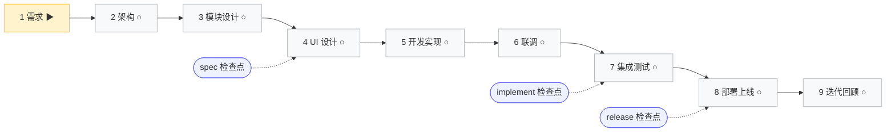

/* 手册母本的策展静态区（源，不是产物）。Task 5.8 由 reshape-58 / rebuild-static-58 抽出。
   § 之前 = 手册抬头（含名词速查与不变式）；之后每段 = 一个环节：引言 → @@STEP 壳 → @@TAIL 尾注。
   壳里只放扫读字段，`**提示词**：{{PROMPT}}` 由构建器换成骨架正文；本文件一处都不许写提示词正文。
   外层「输入物」不设字段：材料清单的唯一出处是提示词框内的「我能提供的材料」（两处各写一份就是第二事实源）。 */
## SDD 全流程提示词手册

**当前进度**：环节 1 需求（1/9）｜规模分诊：待需求声明后判定（≤5 文件 → `/quick-spec` 快速通道；常规 → 3 道检查点；中大型 → SDD 全链）｜依据：`maturity.prd=false`

> **怎么用**：找到当前进行中的步骤（🔄），复制其「提示词」代码框内容（替换 `{占位}` 后粘贴执行）。只有 1·1 需要你填写想法，其余步骤由 AI 根据前序产出自动绑定参数。每完成一步，下次同步自动回填后续步骤参数并刷新状态。
>
> **状态图例**：✅ 已完成｜🔄 进行中｜⬜ 待开始｜⏭️ 跳过
>
> **折叠渲染说明**：环节 5/9 为路径分叉环节，运行期按 /live-refresh 折叠渲染只展开选中路径，本模板为初态全量展示（22 步）。环节5：后端=5·2／前端=5·3／全栈=5·4；环节9：新功能=9·2／缺陷=9·3／重构=9·4，9·1 分诊与 9·5 收尾恒渲染。Backend-Only 应用环节 4 整体跳过（⏭️）。
>
> **不变式**：环节区块数 == 9（横切 Hooks 不占编号环节）；步骤区块数 == Σ各环节（选中路径/分支）步骤数（v9.0.0 全链 22 步：环节1=3／环节2=2／环节3=2／环节4=2／环节5=4／环节6=1／环节7=2／环节8=1／环节9=5）。

📖 名词与路径速查（第一次用手册，先看这块就够）

| 名词 | 一句话解释 | 落在哪里 | 哪个步骤产出 |
|------|-----------|----------|--------------|
| MRD | 市场需求文档：为什么做、为谁做、期望什么结果 | docs/prd/MRD-{项目代号}.md | 1·1 |
| PRD | 产品需求文档：一个应用一份，含用户故事与验收标准 | docs/prd/PRD-{应用}.md | 1·2 |
| 交互原型 | 可点击的页面工程，只用于评需求，不接真实接口 | docs/prd/PRD-{应用}-交互原型/ | 1·3 |
| ARCH | 架构设计：系统骨架、技术选型、部署与容量 | docs/arch/ARCH-{项目代号}.md | 2·1 |
| ADR | 架构决策记录：某项选型为什么这么定、备选是什么 | docs/arch/adr/ADR-*.md | 2·1 |
| 项目交接 | 下一次会话接着干要读的那份：目标、已完成（附证据）、已决策（含被否决方案）、下一步、关键文件 | docs/项目交接.md | 每步收尾 |
| 过关检查点 | 阶段收尾的硬关卡，共 3 关：设计定稿前 / 上线前测试过关 / 发布前 | 各环节标注 | 3·2／7·2／8·1 |
| 定稿锁定 | 定稿后再改要走变更申请，不能直接改文档 | MRD／PRD／ARCH 头部标记 | 1·2／2·2 |
| 六件套 | 模块级"照单施工"设计：后端 / 接口 / 建表 / 前端 / 测试 / 任务 | docs/spec/NNN-slug/ | 3·1 |
| SPEC-UI | 界面设计规范：色彩、字号、间距、组件、四态 | docs/spec/SPEC-UI-{模块名}.md | 4·1 |
| 设计工程 | 可运行的前端界面工程（页面真实样子） | references/ui/ | 4·1 |
| 联调记录 | 模块间接口真实调通的证据 | docs/spec/联调记录-{日期}.md | 6·1 |
| 测试计划 / 测试报告 | 测什么怎么测 / 结果与能不能上线 | docs/test/spec-{业务}-测试计划.md、docs/test/spec-{业务}-测试报告.md | 7·1 / 7·2 |
| 上线记录 | 每次部署的留痕，含可用的回滚命令 | docs/spec/上线记录-{日期}.md | 8·1 |
| 变更目录 | 迭代期一次变更的提案与规格增量 | docs/changes/{变更名}/ → 归档 docs/changes/archive/ | 9·2 |
| 三道过关检查点 | 硬关卡：spec（环节 1-3 收尾）、implement（环节 5-7）、release（环节 8） | 见各步骤「怎样算做完」段 | 各步骤收尾 |

> 每个步骤区块里的「提示词」代码框是唯一需要你复制的内容；代码框上方的四个字段供你扫读，不必复制。

---
§
### 🔄 环节 1 · 需求 —— 把一句话想法变成结构化需求

**核心使命**：多步骤产出 MRD → 按应用多份 PRD（含风格要求采集）→ 交互原型工程；AI 只问不猜，共识达成前不产出

**本环节产出目录**：`docs/prd/`

📗 环节 1 做完你会拿到什么 · 怎么验

- **交付物**：docs/prd/MRD-{项目代号}.md、每个应用一份 docs/prd/PRD-{应用}.md、全栈应用的可点击原型工程 docs/prd/PRD-{应用}-交互原型/
- **看得见的进度信号**：文件树里出现上述文件；MRD 头部有定稿锁定标记与所用专家配置；带界面应用已给出风格要求与视觉方向
- **怎么验**：模糊用语 0 处、量化目标不少于 3 项；原型逐页能点开且页面数与 PRD 交互流程一致；纯后端应用不要求原型
- **卡住时**：关键分歧没裁定就回到 1·1 用选择卡问清；应用类型判不准回到 1·2 的分类矩阵

> **本环节建议**：想法很长时开一个新任务挂着跑；要求它**一次只问一个问题、每题必带推荐项**——拷问式澄清比直接生成文档更省返工。原型出来后务必亲自过一遍：让它截图给你看，别只看文件列表。

@@STEP 1·1
#### 🔄 1·1 说出你的想法，产出 MRD

**你要做的事**：多位专家并行分析后合并成一份 MRD，关键争议先问我再动笔。

**你会拿到**：

**建议怎么用**：复制下面提示词到 Qoder 执行

**提示词**：{{PROMPT}}

@@STEP 1·2
#### ⬜ 1·2 把 MRD 拆成每个应用一份 PRD

**你要做的事**：按已定稿锁定的 MRD 一个应用产一份 PRD，全栈应用顺带问清设计稿依据。

**你会拿到**：

**建议怎么用**：复制下面提示词到 Qoder 执行

**提示词**：{{PROMPT}}

@@STEP 1·3
#### ⬜ 1·3 交互原型工程(仅带界面应用)

**你要做的事**：一套能点开看的交互原型工程，用来在写代码之前把 PRD 里的页面与流程定下来。

**你会拿到**：

**建议怎么用**：复制下面提示词到 Qoder 执行

**提示词**：{{PROMPT}}
§
### ⬜ 环节 2 · 架构 —— 定系统骨架并定稿锁定

**核心使命**：架构设计三合一（C4 双图 + 选型 ADR + 部署容量）→ 找茬小组纠察与定稿锁定；每项选型 ≥2 备选对比，关键决策 ADR 留痕

**本环节产出目录**：`docs/arch/`

📗 环节 2 做完你会拿到什么 · 怎么验

- **交付物**：docs/arch/ARCH-{项目代号}.md（含 C4 容器级图、选型、部署与容量、外部集成、非功能指标表）+ docs/arch/adr/ADR-*.md 不少于 2 篇 + 架构验证报告与定稿锁定版
- **看得见的进度信号**：架构图有真实节点与连线（不再是空图）；三类非功能指标都带数字；ARCH 标注定稿锁定版本
- **怎么验**：每项选型都有不少于 2 个候选对比；找茬小组发现的严重问题全部闭环；模块间依赖矩阵（含共享结构归属、错误码分段、事件归属）齐备
- **卡住时**：技术栈还没定 → 先声明或执行 /harness-assemble；容量数字与需求对不上 → 回到 1·1 补量化目标

> **本环节建议**：用**计划模式**先出方案再动手；架构结论必须写进 `docs/arch/`，别只留在聊天记录里——聊天记录不是交付物。

@@STEP 2·1
#### ⬜ 2·1 架构设计三合一（C4 双图+选型 ADR+部署容量）

**你要做的事**：一份能照着开工的架构文档，系统骨架、选型理由、部署与容量一次说清。

**你会拿到**：

**建议怎么用**：复制下面提示词到 Qoder 执行

**提示词**：{{PROMPT}}

@@STEP 2·2
#### ⬜ 2·2 质量验证+找茬小组+定稿锁定

**你要做的事**：9 项检查点逐项有结论，架构被独立挑完刺并修到闭环，签批定稿锁定后成为唯一上游。

**你会拿到**：

**建议怎么用**：复制下面提示词到 Qoder 执行

**提示词**：{{PROMPT}}
§
### ⬜ 环节 3 · 模块设计 —— 模块级照单施工设计 + 统一校验

**核心使命**：按依赖拓扑分批产出六件套（批内无依赖并行，Provider 先行）+ 统一一致性校验三合一（模块内/完备性/模块间）；spec 主检查点收尾

**本环节产出目录**：`docs/spec/{NNN}-{slug}/`

📗 环节 3 做完你会拿到什么 · 怎么验

- **交付物**：每个模块一个目录 docs/spec/NNN-slug/，内含 SPEC-BE.md、SPEC-API.yaml、SPEC-DDL.sql、SPEC-FE.md、SPEC-TEST.md、tasks.md
- **看得见的进度信号**：模块目录逐个出现；接口契约先于实现定稿锁定；一致性校验记录三段齐备
- **怎么验**：接口在提供方与使用方两侧零差异；建表语句能直接执行；任务清单每项可独立实现与验证
- **卡住时**：架构缺依赖矩阵 → 回 2·2 补；发现设计写到了实现细节 → 移除或下沉（这是 spec 主检查点的关键判据）

> **本环节建议**：**新开一个对话再做校验**，"换个人看"才挑得出毛病（这就是并行子任务的用武之地）；每份文档打开确认路径没错。

@@STEP 3·1
#### ⬜ 3·1 按依赖拓扑分批生成模块设计六件套

**你要做的事**：一套模块级照单施工设计，接口契约先定、建表能直接跑，同批并行

**你会拿到**：

**建议怎么用**：复制下面提示词到 Qoder 执行

**提示词**：{{PROMPT}}

@@STEP 3·2
#### ⬜ 3·2 统一一致性校验（模块内+完备性+模块间）

**你要做的事**：模块内漂移、完备性、模块间对称三道校验并成一次，作为进后续环节的关口

**你会拿到**：

**建议怎么用**：复制下面提示词到 Qoder 执行

**提示词**：{{PROMPT}}
§
### ⬜ 环节 4 · UI 设计 —— 编码前定稿锁定界面结构与交互

**核心使命**：4·1 一次定稿（设计计划三项确认 → 首页面打样 → 并行铺开其余页面 → SPEC-UI 与 references/ui/ 落盘 → G2 验收）→ 4·2 逐页还原核对并建立 G3 基准；最高优先级 Guardrail：用户提供设计工程时，前端实现必须与设计工程完全一致，不得以任何理由偏离；纯后端项目整体跳过（⏭️）

**本环节产出目录**：`references/ui/` 设计工程 + `docs/spec/`（SPEC-UI 与还原核对结论）

📗 环节 4 做完你会拿到什么 · 怎么验

- **交付物**：docs/spec/SPEC-UI-{模块名}.md、references/ui/ 设计工程、docs/spec/还原核对-{模块名}.md（G3 基准）
- **看得见的进度信号**：设计工程能本地起服务（npm install 后 npm run dev），浏览器可逐页点开
- **怎么验**：构建三检 0 错（npm run build、tsc --noEmit、lint）；路由数与 PRD 第 4 章页面清单 1:1；严重与重要视觉问题清零、视觉相似度 ≥90
- **卡住时**：内置设计能力不可用 → 降级为纯 SPEC-UI 文档流程并标注待补项；纯后端应用整环节跳过

> **本环节建议**：单路线，无需选工具——给它风格要求即可，不接 Figma、不收参考图。定稿前务必过 **G2**：用浏览器逐页截图看，或双击 `预览.html`。G2 通过后说一声「UI 定稿」，此后改动走变更申请。

@@STEP 4·1
#### ⬜ 4·1 UI 设计与定稿(G2 验收卡)

**你要做的事**：一套定稿的界面设计——色彩、字号、间距、组件、四态都有书面依据，并有可点的界面工程与设计规范文档。

**你会拿到**：

**建议怎么用**：复制下面提示词到 Qoder 执行

**提示词**：{{PROMPT}}

@@STEP 4·2
#### ⬜ 4·2 还原核对与归档(G3 基准建立)

**你要做的事**：一份还原核对结论与归档结果，确立后续每改一个页面都要过的还原基准（G3）。

**你会拿到**：

**建议怎么用**：复制下面提示词到 Qoder 执行

**提示词**：{{PROMPT}}
§
### ⬜ 环节 5 · 开发实现 —— 按 SPEC 逐层实现

**核心使命**：不写 SPEC 外功能；前置判定 应用类型路由后只展开对应路径（后端=5·2／前端=5·3／全栈并行=5·4）；主 Agent 只编排/派发/审计，严禁自写业务代码；核心逻辑按 SPEC 的验收判据逐层实现，每层留编译与测试证据

**本环节产出目录**：功能代码 + 单测 + progress.txt

📗 环节 5 做完你会拿到什么 · 怎么验

- **交付物**：后端与/或前端工程代码、逐任务提交记录、docs/spec/NNN-slug/tasks.md 全部勾选、实现决策笔记
- **看得见的进度信号**：任务清单从空格变打勾；每层实现后都有编译与测试通过的记录
- **怎么验**：分层没有跳层、接口实现与 SPEC-API 零差异、全量测试与契约测试通过、前端行覆盖率 ≥60%；没有"能编译但起不来"的遗留
- **卡住时**：连续两轮没进展会被标"卡住"→ 由你介入裁定；要改技术选型或动别的模块接口 → 停下来先问

> **本环节建议**：大改动可放心交并行子任务；一个任务一次提交。`.qoder/rules/` 里是它遵守的编码规矩，**你可以直接改**。第一次写代码前它会问你一次 **git 方式**（只本地提交 / 还要推远端 / 暂不纳管）——只问一次，没问到就一直挂在「待你补充」里；框架不代你建仓、不代配 git 身份、不代推送，建仓与换远程都走 `/branch-workflow`。

@@STEP 5·1
#### ⬜ 5·1 确认应用类型，路由开发路径

**你要做的事**：读设计文档判定应用类型，把选中的开发路径与判定依据一起留痕。

**你会拿到**：

**建议怎么用**：复制下面提示词到 Qoder 执行

**提示词**：{{PROMPT}}

@@STEP 5·2
#### ⬜ 5·2 后端实现（任务拆分+Coding Loop+完成处理）

**你要做的事**：后端每个任务逐层实现、每轮都过验收，做完给我一份整体验证结论。

**你会拿到**：

**建议怎么用**：复制下面提示词到 Qoder 执行

**提示词**：{{PROMPT}}

@@STEP 5·3
#### ⬜ 5·3 前端实现（五阶段渐进+交付审核）

**你要做的事**：前端从初始化到接口联调整体做完，每阶段留可看的证据，分叉处由我拍板。

**你会拿到**：

**建议怎么用**：复制下面提示词到 Qoder 执行

**提示词**：{{PROMPT}}

@@STEP 5·4
#### ⬜ 5·4 全栈并行（前后端解耦）

**你要做的事**：全栈应用前后端同时开工、各自做完，再拼一次契约，两边不互相等。

**你会拿到**：

**建议怎么用**：复制下面提示词到 Qoder 执行

**提示词**：{{PROMPT}}
§
### ⬜ 环节 6 · 联调 —— 真实环境打通

**核心使命**：联调一次做完——预检（定方式+留退路+起服务）→ 换真实调用（并行专家、一次一改、契约循环至全绿）→ 报告归档与收尾（四段报告+清理+反思+合并主干）；7 Phase 编排由 integrate-modules skill 承载；敏感值一律环境变量；联调期间不改接口契约（改则回环节 3）

**本环节产出目录**：`docs/spec/联调记录-*.md`

📗 环节 6 做完你会拿到什么 · 怎么验

- **交付物**：docs/spec/联调记录-{日期}.md（启动状态、变更清单、契约测试结果、遗留问题四段）+ 归档提交 + 主干合并提交 + 反思与检查点优化建议
- **看得见的进度信号**：所有模块服务地址与端口可访问；契约测试从部分通过到 100% 通过
- **怎么验**：Mock 调用已逐个换成真实调用（不是一次全换）；契约零差异；破坏性清理动作前有清单确认
- **卡住时**：需要改接口契约 → 回环节 3 改设计再重走；端口冲突或服务未就绪 → 回到 6·1 的预检段重新起服务

> **本环节建议**：让它先"存一份退路"再改代码；端口和地址记进联调记录，出问题时要能对着念。这份"退路"依赖 git 仓库——项目还没建仓就先走 `/branch-workflow` 的第一步（它按"先钉行尾、再建仓"的顺序给你命令）；若你选的是"暂不纳管"，改用复制一份目录做快照替代，并在联调记录里写明依据。

@@STEP 6·1
#### ⬜ 6·1 联调一次到底（预检 → 换真实调用 → 归档收尾）

**你要做的事**：预检、换真实调用、归档收尾一次连着做完（细节归 integrate-modules skill）。

**你会拿到**：

**建议怎么用**：复制下面提示词到 Qoder 执行

**提示词**：{{PROMPT}}
§
### ⬜ 环节 7 · 集成测试 —— 契约一致性与端到端验证

**核心使命**：测试计划与执行合一 → 迭代审查与上线决策（根因迭代至分支覆盖率 ≥80% + 八章报告 + 五角度体检 + 三位评审并行的上线结论）；小项目可合并为单条 /run-tests 提示词一次完成（规模分诊）

**本环节产出目录**：`docs/test/spec-*-测试报告.md`

📗 环节 7 做完你会拿到什么 · 怎么验

- **交付物**：docs/test/spec-{业务}-测试计划.md（10 章）、docs/test/spec-{业务}-测试报告.md（8 章）、测试脚本与执行日志、评审结论与上线决策
- **看得见的进度信号**：用例执行数与通过率有数字；六项检查点阈值逐项有结论
- **怎么验**：分支覆盖率 ≥80%、接口契约零差异、无偶发失败（重复 3 次一致）、必须修复项为 0、上线决策附可用回滚方案
- **卡住时**：结论是"不建议上线" → 按报告阻塞项回环节 5/6 修复后重跑；偶发失败先治稳定性再谈上线

> **本环节建议**：报告看两份就够——能不能上线、卡在哪一条；其余按链接翻。

@@STEP 7·1
#### ⬜ 7·1 测试计划与执行

**你要做的事**：把验收标准与接口契约转成分层测试计划，随即生成脚本批量执行；细节走 run-tests skill。

**你会拿到**：

**建议怎么用**：复制下面提示词到 Qoder 执行

**提示词**：{{PROMPT}}

@@STEP 7·2
#### ⬜ 7·2 迭代审查与决策（根因+报告+多维评审+上线决策）

**你要做的事**：失败用例修到根因、八章报告、代码审查与三位评审的上线决策；细节走 run-tests skill。

**你会拿到**：

**建议怎么用**：复制下面提示词到 Qoder 执行

**提示词**：{{PROMPT}}
§
### ⬜ 环节 8 · 部署上线 —— 发布生产 + 健康检查 + 回滚预案

**核心使命**：上线检查与部署执行二合一（6 项检查清单 + NO-GO 退回 + 破坏性二次确认 + 清理/打包/上传/启动）→ 健康检查与上线记录二合一（/health /ready 冒烟 SLA + 上线记录含回滚命令）；可重复、可回滚、可验证；多环境按环境拆区块

**本环节产出目录**：`docs/spec/上线记录-*.md`

📗 环节 8 做完你会拿到什么 · 怎么验

- **交付物**：部署前检查清单（有你的逐项确认记录）、目标环境运行的服务或镜像（含版本号）、健康检查报告、docs/spec/上线记录-{日期}.md（含可用回滚命令）
- **看得见的进度信号**：/health 与 /ready 返回 200；核心接口冒烟通过；响应时间在服务等级内
- **怎么验**：六项上线检查全部通过；回滚命令不只是写了、而且验证过可行；上线记录九项字段齐备
- **卡住时**：任一健康检查不过 → 立即回滚上一版本再排查；正式版本发布另走 /release

> **本环节建议**：打开 `.qoder/harness-profile.json` 看它记的版本号与同步时间；`.qoder/` 里的 hooks 是自动哨兵（提交前检查、危险命令拦截），不需要你每次确认。

@@STEP 8·1
#### ⬜ 8·1 上线一次到底（检查 → 部署 → 健康检查 → 记录）

**你要做的事**：上线前六项检查、部署执行、健康检查与上线记录四件连着做完；细节走 deploy skill。

**你会拿到**：

**建议怎么用**：复制下面提示词到 Qoder 执行

**提示词**：{{PROMPT}}
§
### ⬜ 环节 9 · 迭代回顾 —— 变更分诊后按分支迭代

**核心使命**：变更分诊后按分支迭代（新功能=9·2 spec-delta 编排链／缺陷=9·3 bugfix 7 步内嵌／重构=9·4 行为不变），收尾 retrospective 恒渲染；架构级回环节 2、模块/接口级回环节 3、仅实现级留本环节

**本环节产出目录**：`docs/changes/`（含 archive/）+ 项目状态的事件记录

📗 环节 9 做完你会拿到什么 · 怎么验

- **交付物**：docs/changes/{变更名}/（提案 + 规格增量 + 任务清单）→ 归档到 docs/changes/archive/；修复代码与回归测试；行为不变的重构提交；经验条目与改进建议
- **看得见的进度信号**：变更目录完成归档且主规格 docs/spec/ 已合并增量；事故条目进入项目状态（面板会出现"存在Bug"徽标）
- **怎么验**：分诊有依据且未介入阶段有豁免说明；缺陷修复有"先复现失败后通过"的证据；重构行为不变（全测试通过、构建成功、差异干净）；产物版本号已按语义化更新
- **卡住时**：判定模糊时不要开工，回到 9·1 用选择卡确认；改进建议未经你确认不会自动改规则与技能

> **本环节建议**：换话题、或觉得它忘了前面时，先让它「更新项目交接」或直接看手册顶部进度表；经验沉淀写进 Qoder 的项目记忆/知识库，下次自动带上。

@@STEP 9·1
#### ⬜ 9·1 变更分诊

**你要做的事**：一个有依据的分支判定，以及这次要不要回到上游重做局部。

**你会拿到**：

**建议怎么用**：复制下面提示词到 Qoder 执行

**提示词**：{{PROMPT}}

@@STEP 9·2
#### ⬜ 9·2 新功能（spec-delta→plan→build→archive 编排链）

**你要做的事**：新功能从提案、规格增量、任务清单到实现与归档整条链走完，细节走 spec-delta 技能。

**你会拿到**：

**建议怎么用**：复制下面提示词到 Qoder 执行

**提示词**：{{PROMPT}}

@@STEP 9·3
#### ⬜ 9·3 缺陷修复（bugfix 7 步内嵌）

**你要做的事**：一个有复现测试背书的修复，加上全量回归结论与变更影响摘要。

**你会拿到**：

**建议怎么用**：复制下面提示词到 Qoder 执行

**提示词**：{{PROMPT}}

@@STEP 9·4
#### ⬜ 9·4 重构简化（行为不变）

**你要做的事**：一批只改结构不改行为的代码，配齐测试、构建结果与复审结论。

**你会拿到**：

**建议怎么用**：复制下面提示词到 Qoder 执行

**提示词**：{{PROMPT}}

@@STEP 9·5
#### ⬜ 9·5 retrospective（经验沉淀）

**你要做的事**：三条分支收口后的经验条目与下一轮改进建议，并做一次产物一致性审核。

**你会拿到**：

**建议怎么用**：复制下面提示词到 Qoder 执行

**提示词**：{{PROMPT}}
